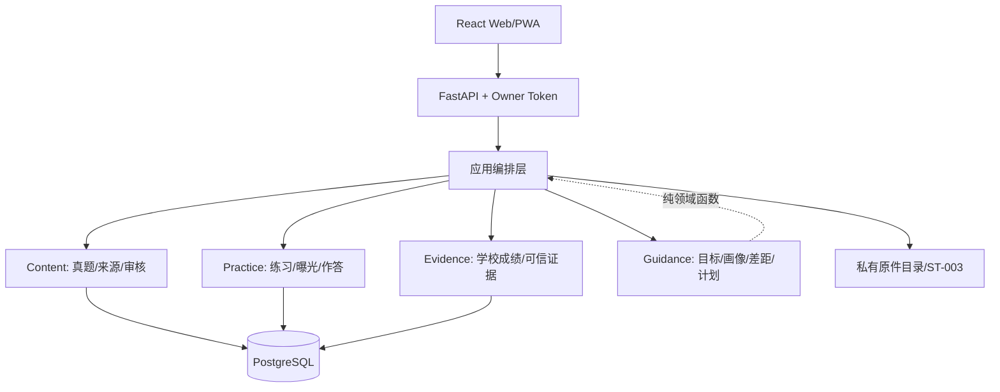

# 系统架构与模块边界

## 架构

一套 FastAPI 模块化单体 + React/Vite Web/PWA + PostgreSQL（开发测试可 SQLite）。四个业务逻辑域由轻量 HTTP/应用编排层调用，**不是四个微服务**。本地 OCR/文本提取由独立适配模块处理，不能与正式判分直接耦合；当前同步解析有时间与输入大小上限，不引入消息中间件。

## 领域职责

| 领域 | 拥有 | 不得做 |
|---|---|---|
| Content | 来源、原卷、草稿、审核、不可变试题版本 | 保存私有校卷、计算画像 |
| Practice | 曝光事实、作答、评分来源、复练 | 修改题库版本、决定全局提升模型 |
| Evidence | 由练习/校卷/复测产生统一能力证据 | 把学校总分摊到考点 |
| Guidance | 已校验输入下的纯函数画像和规则推荐 | 读取图片、OCR、调用 SQLAlchemy/HTTP |

复用优先用组合：文件解析能力可以共享，但真题审核发布、私人校卷核对是不同流程；科目共享记录协议，遇到真实差异才加公式/音频/题组策略。限制跨域直接修改，应用层组合 DTO。不要为未来假设建立插件框架。

当前代码仍采用较小的 `models.py` 和 `main.py`，按任务纵切重构到对应领域，避免预先创建空目录。所有结构应满足 DRY、KISS、YAGNI、SOLID、迪米特法则与组合复用。
