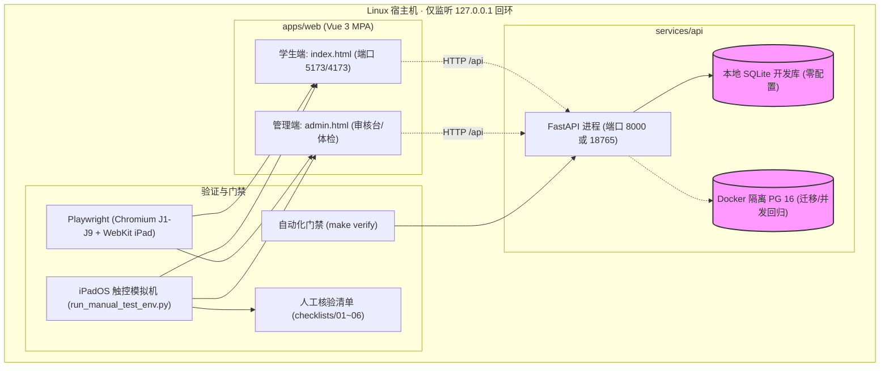
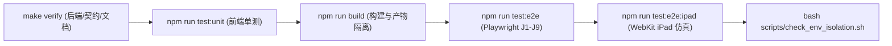

# 开发环境汇总与指南 (Development Environment Guide)

> 本文档为「书童 (Pageboy)」项目的本地开发权威指引。规范了技术栈依赖、`uv` 工具链使用准则、前端 Vue 3 MPA 双入口架构、自动化测试矩阵、iPadOS 模拟机人工验收硬门禁以及开发/生产环境强隔离规则。

---

## 1. 架构定位与开发哲学

书童采用**模块化单体（Modular Monolith）**架构，所有业务领域（题源台账与审核、练习轮换与作答、数学纵向闭环与启发式指导、学校试卷与附件隔离）均运行在单一 FastAPI 进程中。



<details>
<summary>点击查看 Mermaid 开发拓扑源码</summary>



</details>

### 开发核心红线

1. **全链路回环绑定**：本地开发与测试服务（8000、18765、4173、5173）**必须且只能监听回环地址 `127.0.0.1`**，严禁绑定 `0.0.0.0` 或局域网物理 IP。真实 iPad 仅被允许通过安全隧道访问生产环境，严禁直连开发测试端口。
2. **纯粹业务计算隔离**：`services/api/shutong/learning/guidance.py` 必须保持纯函数计算，严禁依赖 HTTP、数据库 ORM、OCR 或外部模型 SDK。
3. **真实数据禁入**：开发树（包括 `private-data/`）仅允许使用程序生成的**虚构测试数据**，绝对禁止检入真实北京中考真题原卷、真实学生试卷扫描件、学生个人信息或任何真实生产机密。

---

## 2. 系统底层依赖清单

本地开发要求 64 位 Linux 操作系统（推荐 Ubuntu 22.04+ 或 Debian 12+）。

| 组件                   | 版本要求            | 用途说明                       | 安装 / 检查方式                                                                    |
| -------------------- | --------------- | -------------------------- | ---------------------------------------------------------------------------- |
| **Linux OS**         | Linux 6.x+      | 宿主机操作系统                    | `uname -srm`                                                                 |
| **Python**           | 3.11+ (推荐 3.14) | 后端运行时                      | `python3 --version`                                                          |
| **uv**               | 0.13.0+         | Python 依赖管理与脚本执行规范         | `uv --version` 或 `curl -LsSf https://astral.sh/uv/install.sh \| sh`          |
| **Node.js**          | 20.x+ LTS       | 前端构建与运行环境                  | `node -v`                                                                    |
| **npm**              | 10.x+           | 前端包管理器                     | `npm -v`                                                                     |
| **Poppler**          | 最新              | PDF 转换为高清晰度图片 (`pdftoppm`) | `sudo apt-get install poppler-utils`                                         |
| **Tesseract OCR**    | 5.x+            | 扫描件试卷自动文本识别引擎              | `sudo apt-get install tesseract-ocr tesseract-ocr-chi-sim tesseract-ocr-eng` |
| **Docker & Compose** | 24.x+           | 运行临时隔离 PostgreSQL 验证迁移与并发  | `docker compose version` (开发用户为 rootless 或非系统 docker 组)                      |
| **Playwright 浏览器**   | 1.64+           | 自动化 E2E 与 iPadOS WebKit 仿真 | `npx playwright install chromium webkit && sudo npx playwright install-deps` |

---

## 3. 工作区目录与职责全景

```
pageboy/
├── apps/
│   └── web/                     # 前端工程 (Vue 3 + Vite MPA 多入口架构)
│       ├── index.html           # 学生端单页入口 (首页/练习/阶段诊断)
│       ├── admin.html           # 审核台多页入口 (题源登记/附件解析/逐题确认/体检)
│       ├── src/                 # 核心视图、组件、工具与中文知识点配置
│       └── tests/               # Playwright E2E 与 WebKit iPad 仿真用例
├── services/
│   └── api/                     # 后端工程 (FastAPI + SQLAlchemy 2.0 + Alembic)
│       ├── shutong/             # 核心逻辑 (auth, ingestion, practice, guidance, school)
│       ├── tests/               # 单元测试与端点测试 (162 项正反例)
│       └── alembic/             # 数据库结构迁移定义脚本
├── contracts/                   # 契约与规范权威快照
│   ├── openapi.yaml             # FastAPI 路由生成的不可篡改 OpenAPI 契约快照
│   └── schemas/                 # JSON Schema (Draft 2020-12) 校验模式与正反例
├── docs/                        # Docs as Code 权威技术与运维文档集
│   ├── engineering/             # 工程与开发规范 (接口契约、开发环境说明)
│   ├── operations/              # 运维与生产规范 (生产环境说明、备份策略、回滚手册)
│   ├── design/                  # 架构设计、数据模型与业务领域权威事实
│   └── quality/                 # 验收索引与阶段质量/演练证据记录
├── scripts/                     # 验证门禁与开发运维工具集
│   ├── run_manual_test_env.py   # 前端测试环境一键拉起/关闭/模拟机管理工具
│   ├── check_env_isolation.sh   # 开发与生产环境隔离规则自动自检脚本
│   ├── check_docs.py            # 文档 Markdown 本地链接与资源解析器
│   ├── check_openapi.py         # 真实 API 与已提交 OpenAPI 快照一致性校验器
│   └── validate_contracts.py    # JSON Schema 正反例全面断言器
├── infra/                       # 生产基础设施、配置模板、部署与备份脚本
├── Makefile                     # 本地快速门禁快捷指令
└── AGENTS.md                    # 项目工程执行契约与红线
```

---

## 4. Python 后端开发规范 (uv 规范)

根据全局工程规范，Python 项目必须统一使用 `uv` 进行依赖管理与脚本执行，避免裸用 `pip`。

### 4.1 虚拟环境初始化

在仓库根目录下创建并激活专有虚拟环境：

```bash
# 创建虚拟环境
uv venv .venv

# 激活虚拟环境
source .venv/bin/activate

# 以可编辑模式安装 API 及测试依赖
uv pip install -e "services/api[test]"
```

### 4.2 依赖安装与执行命令

- **新增第三方库**：
  
  ```bash
  uv add <package_name>
  # 若无法直接通过 uv add 添加，则使用：
  uv pip install <package_name>
  ```
- **运行 Python 脚本**：
  
  ```bash
  uv run python <script_name>
  ```

### 4.3 数据库管理与迁移

本地开发默认使用 SQLite 数据库（固定为 `/media/xc/backup_ext4/pageboy-home/development/data/shutong-dev.sqlite3`，通过 `PAGEBOY_HOME` 统一解析，与启动目录无关，零源码树污染）：

```bash
# 执行数据库迁移到最新版 (Head)
uv run alembic -c services/api/alembic.ini upgrade head

# 检查当前迁移状态
uv run alembic -c services/api/alembic.ini current
```

### 4.4 配置开发令牌与一键启动本地开发环境

开发凭据统一存放在宿主机隔离目录 `/media/xc/backup_ext4/pageboy-home/development/env/dev.env`（`0600` 权限，不进入 Git），前端仅在 `vite dev` 开发模式从已忽略的 `apps/web/.env.development.local` 自动读取并免手动登录（`npm run build` 生产产物绝对不包含任何开发凭据）：

```bash
# 1. 初始化或同步开发双端令牌（dev.env + apps/web/.env.development.local）
uv run python scripts/run_dev_env.py init-env

# 2. 一键启动日常开发环境（自动升级开发库 + 后端 127.0.0.1:8000 + Vite dev 127.0.0.1:5173）
uv run python scripts/run_dev_env.py start

# 3. 查看状态 / 拉起 iPad 模拟机 / 停止服务
uv run python scripts/run_dev_env.py status
uv run python scripts/run_dev_env.py sim
uv run python scripts/run_dev_env.py stop
```

如需手动单起后端，可加载隔离配置后启动 FastAPI（严格锁定 `127.0.0.1` 回环地址）：

```bash
set -a && source /media/xc/backup_ext4/pageboy-home/development/env/dev.env && set +a
uv --directory services/api run uvicorn shutong.main:app --host 127.0.0.1 --port 8000 --reload
```

---

## 5. 前端开发环境与双入口架构 (Vue 3 + Vite MPA)

前端采用 **Vite 多页面架构 (Multi-Page Application, MPA)**，物理隔离学生日常端与后台审核端。

### 5.1 依赖安装与构建

```bash
cd apps/web

# 安装依赖
npm install

# 纯函数单元测试 (针对 KaTeX 公式解析、纯文本转义及知识点中文映射)
npm run test:unit

# 严格类型检查与物理产物构建 (编译产物进行 index/admin 双入口隔离审计)
npm run build
```

### 5.2 前端启动模式

- **开发模式（热重载，监听 127.0.0.1:5173；自动读取 `VITE_DEV_*` 免手动输令牌，点「退出」可复测令牌门）**：
  
  ```bash
  cd apps/web
  npm run dev -- --host 127.0.0.1 --port 5173
  ```
  - 学生端界面：`http://127.0.0.1:5173/`
  - 审核管理端：`http://127.0.0.1:5173/admin.html`
- **生产产物预览模式（模拟真实反代伺服，监听 127.0.0.1:4173）**：
  
  ```bash
  cd apps/web
  npm run preview -- --host 127.0.0.1 --port 4173
  ```

---

## 6. 自动化测试与质量门禁矩阵

提交代码或合并改动前，必须依次通过项目定义的三层自动化门禁：


<details>
<summary>点击查看 Mermaid 门禁矩阵源码</summary>



</details>

| 门禁指令                                      | 执行目录       | 验证范围与核心断言                                                                                                                                                                             |
| ----------------------------------------- | ---------- | ------------------------------------------------------------------------------------------------------------------------------------------------------------------------------------- |
| `PATH="$PWD/.venv/bin:$PATH" make verify` | 根目录        | 聚合门禁：<br>1. `api-test`：162 项后端业务单测全绿<br>2. `contracts`：JSON Schema 正反例校验<br>3. `docs`：自动重绘 Mermaid 静态矢量图、Markdown 全量解析与相对链接检查<br>4. `openapi`：真实 API 路由与 committed openapi.yaml 快照强一致 |
| `npm run test:unit`                       | `apps/web` | Vitest 驱动，测试 KaTeX 富文本拆分与中文本地化映射                                                                                                                                                      |
| `npm run build`                           | `apps/web` | `vue-tsc -b` 零类型报错，Vite 编译产物确保 `dist/index.html` 零 Admin 逻辑与表单泄露                                                                                                                      |
| `npm run test:e2e`                        | `apps/web` | Playwright Chromium 引擎，全自动化执行 J1~J9 完整用户旅程（含题库体检、会话恢复、附件导入与 WCAG A/AA 可访问性零违规）                                                                                                        |
| `npm run test:e2e:ipad`                   | `apps/web` | Playwright WebKit 引擎，iPad 视口仿真（720~980px 响应式断言、触控仿真）                                                                                                                                  |
| `bash scripts/check_env_isolation.sh`     | 根目录        | 环境安全自检：无生产机密泄露、无外部非回环监听、无遗留真实附件                                                                                                                                                       |

### 文档图表自动化维护规范

项目采用 Docs-as-Code 静态矢量图预编译方案。**后续新增或修改 Mermaid 图表时，仅需在 `docs/assets/diagrams/*.mmd` 中调整源文件，执行 `make docs` 即可全自动同步重绘 SVG**。文档中统一采用 `` 直接引用生成的静态矢量图，并在可折叠块（`<details>`）中保留原始 Mermaid 源码，确保在全平台（无网络/无 JS 插件环境、GitHub、VS Code 预览）均能秒级稳定直出。

---

## 7. 开发/生产强隔离自检规则

运行环境自检脚本是防止开发环境意外破坏生产环境的关键防线：

```bash
bash scripts/check_env_isolation.sh
```

脚本将强制校验以下安全不变量：

1. **双环境 Home 目录强隔离**：`/media/xc/backup_ext4/pageboy-home/development` 权限 `0700` 且归属开发用户 `xc`（含 `home.json` 身份声明）；`/media/xc/backup_ext4/pageboy-home/production` 权限 `0710` 且归属 `shutong-prod:shutong-deploy`。
2. **生产机密与数据不可读**：开发用户 `xc` 绝对不可读 `production/env/prod.env`（`0600`）、`production/env/restic-password`、`production/data` 与 `production/repo`。
3. **Docker 权限隔离**：开发用户 `xc` 绝不在系统 `docker` 组中（避免借助宿主 docker daemon 越权访问生产持久卷）。
4. **代码仓库零运行时残留**：源码树 `/media/xc/backup_ext4/code/pageboy` 内严禁残留 `*.sqlite3`、`private-data/`、`services/api/private-data/`、`infra/.env` 或 `infra/.local/`。
5. **服务端口锁定回环**：端口 `18765`、`4173`、`5173`、`8000` 只能在 `127.0.0.1` 监听；`:8180` 不得由开发用户进程占用。

---

## 8. iPadOS 模拟机人工测试与放行门禁 (硬门禁)

> [!CAUTION]
> **前端修改强制人工测试与选项确认门禁**：
> 前端每次功能修改或新增实现，除自动化测试通过外，**必须启动宿主机回环测试服务，向测试人提供模拟机（模拟 iPadOS 环境）操作入口与核验清单。在各项判定全部获得测试人选项式确认通过前，绝对禁止执行 Git 提交！**

### 8.1 一键测试环境管理脚本用法 (`scripts/run_manual_test_env.py`)

```bash
# 1. 启动全套测试环境 (自动建临时库、拉起 API:18765、灌入虚构演示种子、拉起前端预览:4173 并自检连通性)
uv run python scripts/run_manual_test_env.py start

# 2. 查看当前测试服务运行状态与访问地址
uv run python scripts/run_manual_test_env.py status

# 3. 在宿主机桌面上直接弹出 iPad 竖屏 (810×1080) 触控模拟机窗口
uv run python scripts/run_manual_test_env.py sim

# 4. 在宿主机桌面上直接弹出 iPad 横屏 (1080×810) 触控模拟机窗口
uv run python scripts/run_manual_test_env.py sim-landscape

# 5. 人工核验完成后，彻底停止前后端后台测试进程，释放 18765 与 4173 端口
uv run python scripts/run_manual_test_env.py stop
```

### 8.2 选项式核验清单矩阵 (`docs/quality/checklists/`)

测试人需在模拟机中完成对应主题的核验点选：

- `01-gate-and-auth.md`：令牌门进入、页面无痕与记住令牌测试。
- `02-viewport-and-touch.md`：iPadOS 横竖屏触控、按钮点击与滚动流畅度。
- `03-practice-and-assessment.md`：单选、短答、主观题自评链终态。
- `04-diagnosis-and-resume.md`：阶段诊断、未见题切后台会话恢复。
- `05-admin-and-formulas.md`：审核台、附件上传规范指引、中文标签与 KaTeX 公式渲染。
- `06-frontend-isolation.md`：学生端与审核端 MPA 物理隔离及网络反代阻断核验。

---

## 9. 日常开发操作速查 (Cheat Sheet)

```bash
# 1. 同步最新代码并激活虚拟环境
git pull
source .venv/bin/activate

# 2. 本地开发快速验证
make verify                           # 快速跑后端测试 + OpenAPI 校验 + 文档链接
cd apps/web && npm run test:unit      # 跑前端纯函数测试
npm run build                         # 验证前端构建与类型安全

# 3. 运行前端端到端旅程
npm run test:e2e                      # Chromium 完整用户旅程
npm run test:e2e:ipad                 # WebKit iPad 响应式仿真测试

# 4. 涉及前端变更时启动模拟机人工测试
uv run python scripts/run_manual_test_env.py start
uv run python scripts/run_manual_test_env.py sim
# 测试人在模拟机中对照 docs/quality/checklists/*.md 逐项核验并签署结果
uv run python scripts/run_manual_test_env.py stop

# 5. 提交前终验
bash scripts/check_env_isolation.sh   # 检查环境强隔离
git status                            # 确认无机密与无临时文件残留
```
