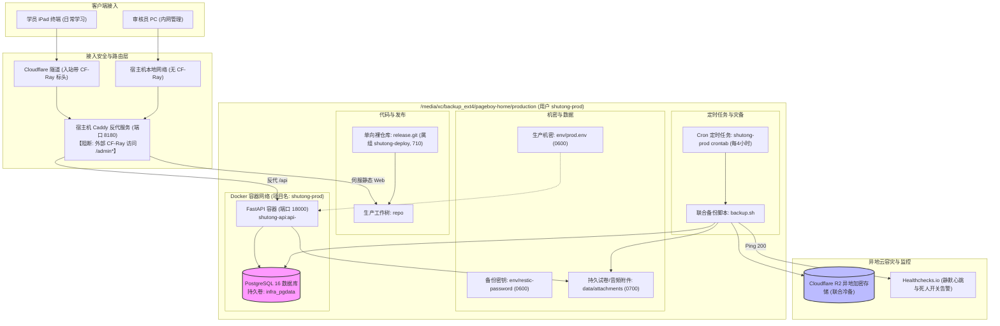
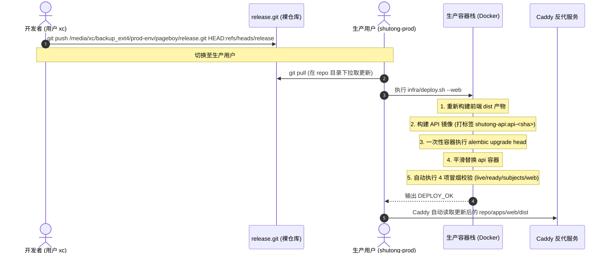
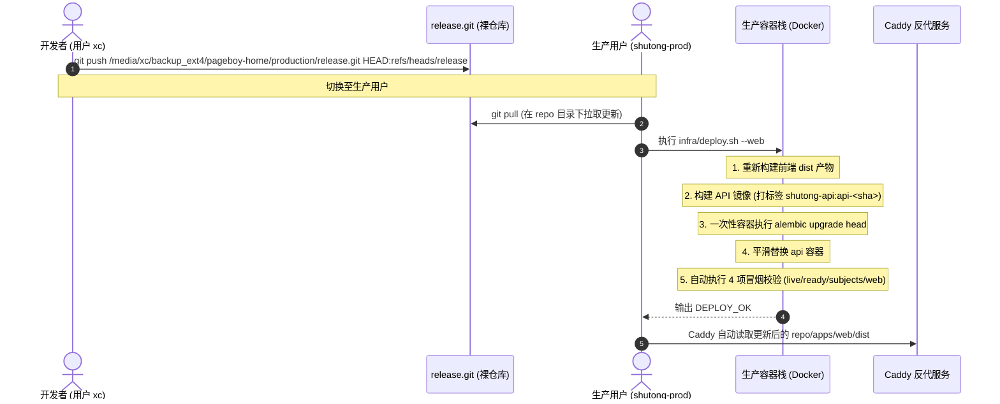

# 生产环境汇总说明与运维指南 (Production Environment Guide)

> 本文档为「书童 (Pageboy)」项目的生产运行环境权威规范与日常运维手册。阐明宿主机生产拓扑、专用权限体系、Caddy 反向代理安全阻断、单向代码发布流、秒级容器回滚以及 R2 异地联合容灾与静默告警机制。

---

## 1. 生产环境定位与架构全景

书童生产环境部署于宿主机统一运行根目录下的隔离环境 `/media/xc/backup_ext4/pageboy-home/production`，与开发环境 `/media/xc/backup_ext4/pageboy-home/development` 在同一 `PAGEBOY_HOME` 下按 OS 用户与 `home.json` 身份实现彻底隔离，采用宿主机反向代理（Caddy）与容器化服务（Docker Compose）协同架构，保障真实学员日常学习与真题原卷资产的高可靠运行。



<details>
<summary>点击查看 Mermaid 架构拓扑源码</summary>


</details>

---

## 2. 生产用户与权限安全体系

为杜绝开发过程对生产环境的误触与机密泄露，系统在宿主机实行严格的多用户隔离：

| 实体 / 账户 | 身份定义 | 权限边界与所属组 |
|---|---|---|
| **`shutong-prod`** | 生产专用非特权系统账户 | 拥有 `/media/xc/backup_ext4/pageboy-home/production` 的完全所有权；加入宿主 `docker` 组以管理容器；**无登录口令，仅限管理员经 `sudo -iu shutong-prod` 提权进入**。 |
| **`shutong-deploy`** | 部署通信用户组 | 仅对 `release.git` 裸仓库具备读写（推送）权限；绝对无法读取生产目录下的 `env/`（0600）与 `data/`（0700）。 |
| **`xc` (开发用户)** | 本地开发者账户 | 隶属于 `shutong-deploy` 组，负责日常开发与代码提交，只能通过 Git 向 `release.git` 推送分支，无系统 `docker` 权限。 |

---

## 3. 持久化存储与配置布局

生产根目录 `/media/xc/backup_ext4/pageboy-home/production` 的标准目录结构：

```
/media/xc/backup_ext4/pageboy-home/production/
├── home.json             # 生产环境身份清单 (0600, pageboy-production)
├── release.git/          # 单向发布裸仓库 (属组: shutong-deploy, 2770)
├── repo/                 # 生产代码检出工作树 (权限: 750, 从 release.git pull)
│   ├── apps/web/dist/    # 生产 Web 静态编译产物 (由 Caddy 直接伺服)
│   └── infra/            # 生产部署、回滚与容器配置文件
├── env/                  # 生产机密专有目录 (权限: 700)
│   ├── prod.env          # 生产核心环境变量与口令 (权限: 0600)
│   └── restic-password   # R2 异地备份 restic 独立加密密钥 (权限: 0600)
├── data/                 # 真实生产数据资产目录 (权限: 700)
│   ├── attachments/      # 真实试卷原件 PDF、图片与听力音频 (权限: 700)
│   └── curriculum_standards/ # 四科教育部 2022 版官方课标 PDF 原件 (权限: 700)
├── bin/                  # 生产常驻依赖工具 (caddy, restic 等, 权限: 750)
└── logs/                 # 生产服务运行与轮转日志目录 (权限: 750)
```

### 核心环境变量速览 (`env/prod.env`)
- `PAGEBOY_HOME=/media/xc/backup_ext4/pageboy-home`：统一运行根目录。
- `SHUTONG_ENV=prod`：生产环境标识，应用通过 `/health/live` 自报环境，防止演示脚本误写真实库。
- `DATABASE_URL`：连接生产专用 PostgreSQL 16 实例。
- `SHUTONG_TOKEN`：学员与管理员访问生产 API 的高强度强密钥。
- `ATTACHMENTS_DIR`：挂载物理路径指向 `/media/xc/backup_ext4/pageboy-home/production/data/attachments`。
- `SHUTONG_STANDARDS_DIR`：挂载物理路径指向 `/media/xc/backup_ext4/pageboy-home/production/data/curriculum_standards`。

---

## 4. 系统服务与网络路由守护

### 4.1 Systemd 服务矩阵
生产环境常驻运行以下关键 Systemd 服务与定时器：

1. **`shutong-caddy.service`**：
   - 宿主机反向代理网关，监听 `127.0.0.1:8180`，统一承接 Web 静态页面与 `/api` 转发。
2. **`shutong-prod crontab`（每 4 小时备份任务）**：
   - 通过 `shutong-prod` 用户 `crontab` 每 4 小时触发一次联合异地容灾备份，执行 `infra/backup.sh` 并静默上报心跳。
3. **`cloudflared` (Cloudflare Tunnel)**：
   - 建立公网安全加密隧道，将分配的域名流量引入宿主机 Caddy（8180 端口）。

### 4.2 Caddy 反代安全阻断机制 (CF-Ray 阻断)
为确保生产环境安全，审核管理功能（`/admin*`）仅限内网访问：
```caddy
# 生产 Caddyfile 核心防护规则：
@blocked_admin {
    header CF-Ray *
    path /admin*
}
respond @blocked_admin "Forbidden" 403
```
- **学员 iPad**：经由 Cloudflare 隧道入站，请求头携带 `CF-Ray`，仅被允许访问学生端（`/`、`/index.html`）与公开做题 API。
- **外部攻击者**：任何经由隧道尝试访问 `/admin.html` 或管理接口的请求，在反代层被直接截断并返回 403 Forbidden，零请求穿透进内部 API。

---

## 5. 标准化单向发布流 (Release Pipeline)

生产环境遵循**单向代码发布**模式（开发 Push -> 生产 Pull），保障生产环境不受开发分支污染。



<details>
<summary>点击查看 Mermaid 发布时序源码</summary>


</details>

### 完整部署执行命令
```bash
# 步骤 1：开发机提交并通过本地门禁后，推送到生产发布裸仓库
cd /media/xc/backup_ext4/code/pageboy
git push /media/xc/backup_ext4/pageboy-home/production/release.git HEAD:refs/heads/release

# 步骤 2：切换至生产专用用户
sudo -iu shutong-prod

# 步骤 3：在生产检出代码库拉取并执行部署
cd /media/xc/backup_ext4/pageboy-home/production/repo
git pull
infra/deploy.sh --web

# 步骤 4（首次 V2 上线或新增课标体系后）：在容器内幂等审核并发布四科 v2022.1.0 知识体系
docker compose --env-file ../env/prod.env -f infra/compose.yaml -f infra/compose.local.yaml exec -T api \
  python -m shutong.taxonomy_audit
```

> **环境变量与课标原件前提**：`prod.env` 须额外配置双凭据（`SHUTONG_ADMIN_TOKEN` 与 `SHUTONG_STUDENT_TOKEN` 且两者不等）及 AI 引导配置（`SHUTONG_AI_BASE_URL`、`SHUTONG_AI_API_KEY`、`SHUTONG_AI_MODEL`）；且宿主机须将四科教育部 2022 版课标官方 PDF 原件放置于 `SHUTONG_STANDARDS_DIR`（默认 `../private-data/curriculum_standards`）供只读挂载通过发布门禁校验。

---

## 6. 应急秒级回滚机制

当线上出现异常时，系统支持秒级无缝回滚至上一个稳定版本。

### 6.1 触发回滚命令
```bash
sudo -iu shutong-prod
cd /media/xc/backup_ext4/pageboy-home/production/repo

# 回滚到上一个已部署标签 (读取 infra/.local/previous-tag)
infra/rollback.sh

# 或显式回滚到指定的已知稳定镜像标签
infra/rollback.sh api-198ad7a
```

### 6.2 回滚核心边界与数据红线
- **仅切镜像，不降级 Schema**：`rollback.sh` 仅做 Docker 容器镜像的秒级替换，**绝对不自动执行数据库降级（Alembic Downgrade）**。数据库结构回滚属于不可逆重大操作，必须经人工审计，并按 [recovery-runbook.md](recovery-runbook.md) 执行独立备份与还原。
- **本地镜像保留**：部署脚本会自动归档上一个可用镜像标签，确保回滚即时生效。

---

## 7. 灾备、恢复与监控保障

### 7.1 Cloudflare R2 异地联合备份 (AC-OPS-01)
系统每 4 小时全自动执行一次**数据库与附件联合备份**：
1. **内容打包**：PostgreSQL 压缩 Dump + 试卷附件 `tar.gz` 归档。
2. **防篡改指纹**：自动生成 `SHA256SUMS` 与包含当前数据库 `migration_revision` 的 `manifest.json`。
3. **加密外存**：通过 `restic` 将联合数据加密推送到 Cloudflare R2 异地对象存储桶。

### 7.2 静默死人开关告警 (AC-OPS-02)
- 每次备份成功完成后，脚本向 `https://hc-ping.com/<UUID>` 发送 HTTP 200 脉冲。
- 若备份连续 5 小时（4小时计划 + 1小时宽限）未成功发出心跳，Healthchecks.io 将通过静默告警通道（邮件/Webhook）触发告警通知管理员。

### 7.3 灾难恢复演练
恢复流程完全脚本化，杜绝在生产中手工误敲危险命令：
```bash
# 在明确隔离的全新临时环境中执行演练检验
bash infra/restore.sh <backup_tarball_path>
```
详细的容灾备份策略见 [backup-policy.md](backup-policy.md)，实战演练手册见 [recovery-runbook.md](recovery-runbook.md)。

---

## 8. 日常生产运维命令速查 (Operations Cheat Sheet)

```bash
# 1. 登录生产用户
sudo -iu shutong-prod
cd /media/xc/backup_ext4/pageboy-home/production/repo

# 2. 检查生产容器运行状态
docker compose --env-file ../env/prod.env -f infra/compose.yaml -f infra/compose.local.yaml ps

# 3. 检查反向代理 Caddy 运行状态与日志
sudo systemctl status shutong-caddy.service --no-pager
sudo journalctl -u shutong-caddy.service -n 50 --no-pager

# 4. 执行在线健康探针探测 (自报环境与镜像版本)
curl -s http://127.0.0.1:18000/health/live | jq .
curl -s http://127.0.0.1:18000/health/ready | jq .
curl -s -I http://127.0.0.1:8180/ | head -5

# 5. 手动触发一次生产异地联合备份
cd /media/xc/backup_ext4/pageboy-home/production/repo/infra
bash backup.sh

# 6. 查看 R2 异地备份快照列表
export RESTIC_PASSWORD_FILE=/media/xc/backup_ext4/pageboy-home/production/env/restic-password
/media/xc/backup_ext4/pageboy-home/production/bin/restic snapshots
```
