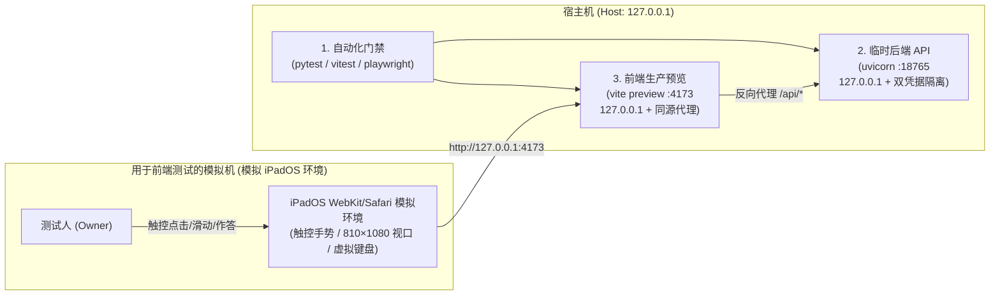
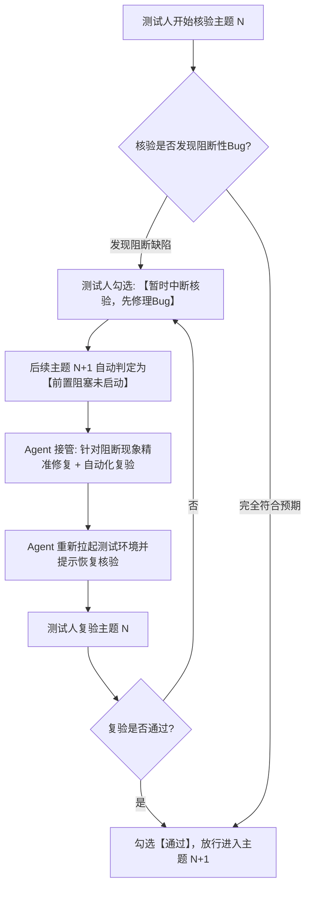

# 前端人工验收操作指南与常驻标准 (Manual Acceptance Guide)

> **工程红线准则**：
> 1. **执行拓扑分工**：所有前后端测试（单元测试、构建、自动化回归）在宿主机上完成；前端人工测试必须在**用于前端测试的模拟机（模拟 iPadOS 环境）**中运行与操作完成。
> 2. **网络服务就绪（严格回环监听）**：交付人工核验前，宿主机必须启动仅监听回环地址（`127.0.0.1`）的前后端测试服务并完成连通性探针检验，确保模拟机测试人能够即时打开测试界面。**根据 `AGENTS.md` 核心契约，严禁开发/测试服务监听 `0.0.0.0` 或局域网物理地址（真实 iPad 仅访问生产环境，防止内网非授权暴露）**。
> 3. **选项式门禁**：前端每一次功能新增、交互调整或缺陷修改实现后，必须向测试人提供自适应选项式人工测试报告，**在每个人工测试点未全部获得测试人确认通过前，绝对禁止执行 git 提交**。

---

## 一、 验收准备与测试拓扑规范

根据工程契约，人工测试遵循**“宿主机运行服务与自动化，用于前端测试的模拟机执行 iPadOS 人机交互核验”**的拓扑结构：



### 1. 宿主机一键启动测试服务（推荐）

项目提供了集环境自检、建表、种子数据注入与双服务拉起于一体的管理脚本：

```bash
# 一键启动测试后端、注入种子数据并拉起前端预览（绑定 127.0.0.1 回环安全地址）
uv run python scripts/run_manual_test_env.py start

# 检查测试服务健康状态
uv run python scripts/run_manual_test_env.py status

# 测试完成后一键停止服务与释放端口
uv run python scripts/run_manual_test_env.py stop
```

#### 手动分步启动备选方式
如需独立调试各服务：
- **终端 1（后端，双凭据隔离）**：`SHUTONG_STUDENT_TOKEN=test-student-secret SHUTONG_ADMIN_TOKEN=test-admin-secret uv run python -m uvicorn shutong.main:app --host 127.0.0.1 --port 18765`
- **终端 2（前端，生产预览）**：`cd apps/web && API_PROXY_TARGET=http://127.0.0.1:18765 npm run preview -- --host 127.0.0.1 --port 4173`
- **探针自检**：`curl -I http://127.0.0.1:4173/` 与 `curl -H "Authorization: Bearer test-student-secret" http://127.0.0.1:4173/api/student/verify`

---

### 2. iPadOS 模拟机具体使用与操作方式

由于 Linux 宿主机原生不具备 Apple macOS 专有 Xcode 闭源模拟器，书童工程体系提供了两种等价且高度保真的**用于前端测试的 iPadOS 模拟机使用方式**（均通过回环安全地址 `127.0.0.1` 访问）：

#### 方式 A：【一键调出】独立 iPadOS 模拟机图形窗口（最推荐）
无需任何复杂配置，在宿主机桌面终端直接运行：
```bash
# 1. 弹出 iPad (gen 7) 竖屏窗口 (810 × 1080)
uv run python scripts/run_manual_test_env.py sim

# 2. 弹出 iPad (gen 7) 横屏窗口 (1080 × 810)
uv run python scripts/run_manual_test_env.py sim-landscape
```
- **窗口特性**：
  - 分别对应 `iPad (gen 7)`（竖屏 `810×1080`）与 `iPad (gen 7) landscape`（横屏 `1080×810`）；
  - 鼠标光标自动转换为手指触摸圆点（Touch Simulation）；
  - 窗口内已自动加载 `http://127.0.0.1:4173` 并直连测试后端，测试人可直接在窗口中进行横竖屏布局对比与交互作答；
  - 测试完毕关闭窗口即可。

#### 方式 B：【浏览器仿真】在现有浏览器 DevTools 中一键翻转屏幕
测试人打开宿主机桌面浏览器（Chrome / Edge / Chromium）：
1. 访问测试入口：`http://127.0.0.1:4173`；
2. 按 `F12` 打开开发者工具，按快捷键 `Ctrl + Shift + M`（进入移动设备仿真工具栏）；
3. 在顶部设备下拉菜单中选择 **「iPad」**（或 **iPad Air / iPad Mini**）；
4. **一键横竖屏切换**：
   - 默认进入 **竖屏（810 × 1080）**：核验整页零横向溢出、卡片纵向自然堆叠；
   - 点击设备工具栏顶部右侧的 **「旋转屏幕 / 切换屏幕方向 (Rotate)」** 图标：
     页面立即翻转为 **横屏（1080 × 810）**，核验页面主体被 `.page` 的 `980px` 上限精确居中收束，两侧留白均匀。
5. 页面自动开启触摸手势支持，可在此模式下进行全项核验。

- **测试凭据**：
  - 学生端访问令牌：`test-student-secret`
  - 管理端访问令牌：`test-admin-secret`

---

## 二、 人工测试主题清单索引表 (分项文档结构)

为保证测试追溯性与纪律性，**每一个测试主题的详细核验清单已分别独立生成，保存在 `docs/quality/checklists/` 目录树中**：

| 主题编号 | 独立清单文档链接 | 核心核验内容 | 前置依赖条件 | 当前核验状态 (点选生效) |
| :---: | :--- | :--- | :--- | :--- |
| **主题 1** | [01-gate-and-auth.md](checklists/01-gate-and-auth.md) | 令牌门表单必填拦截、错误令牌提示、有效令牌登录、刷新免密进入、退出彻底销毁 | 无（全站首要门禁） | **[x] 已通过**（2026-11-02 测试人点选放行） |
| **主题 2** | [02-viewport-and-touch.md](checklists/02-viewport-and-touch.md) | iPad 竖屏零横向滚动、横屏 980px 居中收束留白、Tab 与学科触控切换流畅 | 依赖【主题 1 通过】 | **[x] 已通过**（2026-11-02 测试人点选放行） |
| **主题 3** | [03-practice-and-assessment.md](checklists/03-practice-and-assessment.md) | 练习题目轮换不重复、单选题作答与来源标明、主观题参考答案展示与自评锁定 | 依赖【主题 1、2 通过】 | **[x] 已通过**（2026-11-02 测试人点选放行） |
| **主题 4** | [04-diagnosis-and-resume.md](checklists/04-diagnosis-and-resume.md) | 未见题严肃纪律、**未答切后台/按 F5 刷新自动恢复未答题（ST-018，防空烧）** | 依赖【主题 1、2、3 通过】 | **[x] 已通过**（2026-11-02 测试人点选放行） |
| **主题 5** | [05-admin-and-formulas.md](checklists/05-admin-and-formulas.md) | 审核台 `v-model` 表单录入、**附件本地文件浏览与试卷规范指引**、**知识点配置化本地化**、KaTeX 复杂公式专业排版、非规范 `$` 纯文本安全回退 | 依赖【主题 1~4 通过】 | **[x] 已通过**（2026-11-02 测试人点选放行） |
| **主题 6** | [06-frontend-isolation.md](checklists/06-frontend-isolation.md) | 前端管理与使用功能物理强隔离、学生端纯净无审核与校考表单、管理端综合工作台、外网 Cloudflare 隧道 403 阻断 | 依赖【主题 1~5 通过】 | **[x] 已通过**（2026-11-06 测试人点选放行） |
| **主题 7** | [07-p01-isolation.md](checklists/07-p01-isolation.md) | P0-1 权限与知识展示隔离边界验收（双凭据互斥拦截、学生端纯自然语言建议、无内部编码泄露、管理端审核完备） | 依赖【主题 1~6 通过】 | **[x] 已通过**（2026-11-07 测试人点选放行） |

---

## 三、 中断与先修Bug协议 (Halt & Fix Protocol)

为坚守「先验收，后实施」与工程红线，人工测试执行严格的**串行放行与阻断先修机制**：



<details>
<summary>点击查看 Mermaid 协议流程源码</summary>


</details>

### 1. 中断触发规则
- **单项阻断即全线暂停**：若某个测试点未修复通过，**禁止强行进行后续测试点**（例如令牌门未通则无法测试练习，未见题刷新丢失则破坏曝光账本）；
- **点选生效**：测试人只需在对应核验清单文档中勾选 `[x] 判定 3：暂时中断核验，先修理Bug`，并在下方记录缺陷现象；
- **后续自动阻塞**：所有依赖该主题的后续清单自动锁定为 `[x] 判定 4：前置阻塞未启动`。

### 2. Agent 响应与闭环流程
1. Agent 接收到测试人的中断指令与缺陷反馈后，立即停止核验推进；
2. 依据 `AGENTS.md` 契约执行精准手术式修复（Surgical Change），先补充复现单测/自动化断言，再修复源码；
3. 在宿主机上运行自动化门禁（Vitest + Playwright + 构建）；
4. 重新加载测试服务环境并更新清单状态，提示测试人解除阻塞、恢复现场核验。

---

## 四、 验收放行标准 (Go / No-Go 准则)

在完成上述全部 5 个场景的核验后，**当且仅当满足以下全部条件**，方可确认人工验收通过：

1. **选项式全绿**：上述判定表中的 5 项核心测试点，测试人全部选定为「通过」；
2. **零未捕获异常**：打开浏览器开发者工具 Console 面板，整个测试操作路径中无任何未捕获错误（Uncaught TypeError/ReferenceError）；
3. **状态响应一致**：表单输入流畅，Tab 与学科切换无残余状态干扰；
4. **视觉布局完整**：原生 CSS 规范与色彩对比度符合 WCAG AA 要求，在平板竖横屏下无布局撕裂；
5. **业务红线严格坚守**：
   - 缺证据显示「证据不足」，绝不虚构 0 分；
   - 学校考试总分明示「不产生考点证据」；
   - 绝不推算未经校准的中考成绩预测。

---

## 五、 验收通过后的 Git 提交命令

**在且仅在上述人工测试判定表全部获得测试人确认通过后**，才允许在项目根目录下执行提交：

```bash
# 1. 确认工作树状态
git status

# 2. 将修改与新增文件暂存
git add apps/web docs/ task.md

# 3. 提交至本地 Git 分支（符合 Conventional Commits 规范）
git commit -m "refactor(web): migrate frontend from React 19 to Vue 3.5

- Replace React 19 toolchain with Vue 3.5 + @vitejs/plugin-vue + vue-tsc
- Migrate all views and components with equivalent v-model and composition API
- Optimize bundle size by -26.9% (547kB -> 400kB, gzip 129kB)
- Retain full test coverage (Vitest 9/9, Playwright E2E 17/17 + WebKit 20/20)
- Add manual acceptance guide into project docs tree"
```
