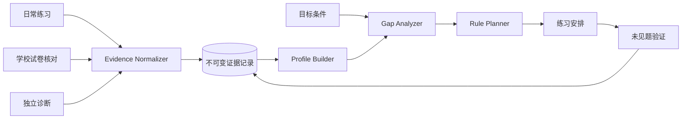

# 书童 V1.5 工程架构设计原则评估与 V1.6 精简建议

> 状态：**评估报告 / 待决策**，未修改 V1.5 原始工程。  
> 评估时间：2026-10-17  
> 范围：`书童-Docs-as-Code-V1.5` 实际工程内容、从 V1.4 迁移的核心产品、数据和运维设计。  
> 适用条件：四门主科、个人非商业使用、Web/PWA、目标/现实能力画像与差距驱动训练。

## 1. 执行摘要

**判断：架构路线可保留，但应先做一次精简与契约加强，再进入正式编码。**

- 保留：模块化单体、统一试题实体、不可变作答证据、GAP Engine 的目标—现实—训练—独立验证闭环、私有资源隔离、异地备份与可恢复性。
- 优先修复：JSON Schema 测试并未真正验证 Schema；本地文档检查不能检测失效图片链接；有多处相同规范重复出现；CI 对部分根目录治理文件变化不触发；MVP 的设计跨度超出个人项目应承担的早期实现量。
- 核心方向：**一份权威契约 + 单条可用业务纵切 + 足够但不过量的运行保障**。

### 1.1 启发式评分（非实测质量指标）

| 原则 | 评分/10 | 说明 |
|---|---:|---|
| DRY | 6.5 | 历史与现行分离良好，规范与 API/验收在多处复述 |
| KISS | 6.5 | 技术栈简单，但个人项目治理层过细 |
| YAGNI | 5.5 | 微服务等被暂缓，但画像、表模型、运维和所有学科功能大量预先设计 |
| 组合优于继承 | 8.0 | 模块化单体和共同证据框架合理；代码级组合方式需明确 |
| SRP/高内聚低耦合 | 8.0 | 主要业务边界清楚，部分文档混合业务/API/数据库职责 |
| 文档工程可验证性 | 7.5 | 有检查脚本、CI、站点严格构建，但存在显著漏检 |

六项**等权平均为 7.0/10**。若按 DRY、KISS、YAGNI 各 15%，组合与复用、SRP 各 20%，文档可验证性 15% 加权，**综合为 7.1/10**。这些都是启发式评估，结果应以具体阻断问题为准，不应把主观分数当作量化软件可靠性数据。

## 2. 实测核查结果

审核 22 份现行 Markdown 页面、4 份历史原稿、2 个检查脚本、1 份 JSON Schema、1 条 CI 工作流与 `zensical.toml`。执行：

```bash
python scripts/check_docs.py
python scripts/check_contracts.py
```

均报告 PASS，但本次建立独立临时拷贝进行负面测试：

1. 将 `contracts/source-manifest.example.json` 中 `exam_year` 改为字符串、`source_url` 改为非法网址，`scripts/check_contracts.py` **仍返回 0 与 PASS**。原因：程序只进行字段集合、枚举等局部 `assert`，没有调用符合 Draft 2020-12 的实际验证器和 format 检查。
2. 在 `docs/index.md` 增加 ``，`scripts/check_docs.py` **仍返回 0 与 PASS**。原因：文档链接提取正则显式跳过 ``，未检测图片资源。
3. `.github/workflows/docs-check.yml` 的 `paths` 过滤包含 `docs/**`、`contracts/**` 等，但未包含 `AGENTS.md`、`CONTRIBUTING.md`、`README.md` 和 `.github/PULL_REQUEST_TEMPLATE.md`。这些文件单独变更可能不会触发文档 CI。
4. 已确认 V1.5 ZIP 能正常解压；未实测 Zensical 站点构建和 GitHub Actions 在线执行。

**结论：当前所谓“通过”是基本结构检查通过，不等于契约或全部 Markdown 引用检查通过。**

## 3. 关键问题与修复建议

| ID | 严重度 | 设计原则 | 具体证据 | 修改建议 |
|---|---|---|---|---|
| F01 | P0 | KISS / 正确性 | `scripts/check_contracts.py` 仅结构断言，错误类型数据可通过 | 用 `jsonschema.Draft202012Validator(..., format_checker=...)` 执行真正 Schema 校验，加入故意无效数据的单元测试；移除使用 `assert` 承担运行时校验 |
| F02 | P0 | 质量门禁 | `scripts/check_docs.py` 不检查失效 Markdown 图片 | 用成熟 Markdown 解析器或补充独立资源引用检测；在 CI 执行真实 `zensical build --strict` 并增加含错误图片的负面测试 |
| F03 | P0 | DRY | `docs/02-design/gap-engine.md` 与 `docs/04-engineering/tech-and-api.md` 均描述 GAP API；`docs/01-product/roadmap.md` 与 `docs/06-quality/acceptance.md` 均描述验收要求 | 业务文档只写业务规则与理由；接口只有一处正式契约；可执行验收只有一处正式测试或验收用例，其余链接引用 |
| F04 | P0 | 变更一致性 | CI 的 `paths` 排除了根目录代理/贡献规范 | 将 `AGENTS.md`、`README.md`、`CONTRIBUTING.md`、`.github/PULL_REQUEST_TEMPLATE.md` 加入触发路径，或删除 paths 过滤以减少维护 |
| F05 | P1 | YAGNI | `gap-engine.md` 在尚无可运行应用时已提出多状态机、多个版本表和十余个 API | 只固化必须保持正确的业务不变量；候选表/API 在第一条纵切开发中按实际需求落地 |
| F06 | P1 | DRY / KISS | `docs-policy.md`、`change-control.md`、`traceability.md`、`migration-map.md`、`AGENTS.md`、`CONTRIBUTING.md` 存在治理重叠 | 以 `AGENTS.md` 写代理开发硬约束、`CONTRIBUTING.md` 写人类贡献流程、单份 docs-policy 写文档规范；追溯表待真实测试存在后再维护；迁移映射归档 |
| F07 | P1 | DRY | `runtime.md`、`backup.md`、`disaster-recovery.md` 多处包含备份/RPO/RTO 规则 | 保留部署/备份/恢复的职责边界；**仅在 backup 策略**定义频率与保留期，**仅在 recovery**定义恢复流程，其他位置只引用或摘要 |
| F08 | P1 | 单一事实源 | 多份页面要求 `doc_id/title/status/owner/source_version/updated`；其中 `title` 与 H1、`updated` 与 Git、`source_version` 与 Git Tag 重叠 | 对普通页面只要求 H1 与少量必要状态；重大决策使用 ADR 状态；版本时间以 Git 为准，减少手工元数据 |
| F09 | P1 | 组合复用 | 真题导入和学校卷上传都需图文识别，但使用范围、保密级别和审核责任不同 | **复用解析基础能力**，不强行复用相同数据发布流程：共享文件哈希/解析器，分别执行真题发布规则与校卷私人证据规则 |
| F10 | P1 | 领域边界 | `mastery_states`/`ability_snapshots`、`recommendation_logs`/`plan_revisions` 可能在后续实现中交叉保存同样结论 | 将原始答题/评分作为权威事件；画像与任务队列视为可追溯派生视图；明确“证据→模型→计划”数据流，避免双写真相 |
| F11 | P2 | KISS | `zensical.toml` 手工完整维护 22 页导航 | 稳定导航可保留；若维护成本上升，可使用 Zensical 的默认目录导航，避免自写导航生成器 |
| F12 | P2 | KISS / YAGNI | 当前设计有完整的未来功能、灾备和 KPI，但无真实负载/题库覆盖和学习效果数据 | 用可验证的纵向演示驱动真实字段、索引、容量、调度参数的引入，而非按预测一次性实现 |

## 4. 对产品核心子系统的建议

### 4.1 真题资源管理

**应立即做：** 资源登记、文件校验、解析、题目编辑、审核、发布与不可变题目版本。四学科使用同一个题目/题组数据契约。

**延后做：** 自动全网采集、复杂爬虫调度、海量资源去重搜索、独立对象存储抽象层、AI 多模型协调。

### 4.2 GAP Engine

**首个端到端闭环**建议只做：

1. 输入一科目标分与时间预算，生成有版本的目标条件；
2. 学生完成一次诊断，导入一次学校考试的**人工确认分数和题目级信息（若可获得）**；
3. 用统一的知识点 ID 和证据类型形成现实表现；
4. 区分“已验证差距 / 证据不足”，采用**规则推荐**选出下一个训练重点；
5. 完成一道或一组未见题的独立验证，决定继续/升级/回退。

先保留目标画像与现实画像的结构一致和可解释性，再扩展多方案分数路径、六维综合统计、复杂优先级权重和机器学习校准。原始校卷分数不得直接宣称等值于中考分数。

### 4.3 四学科设计

**数据契约一开始支持四科**；**研发以完整纵向切片驱动**。先用数学的一套真实合法获取试卷贯通端到端，再验证物理图表、语文阅读题组、英语材料等差异；不能因纵切以数学开头就改变首批四科的既定产品范围。

### 4.4 运行与灾备

保留“一台私有常驻主机 + PostgreSQL + 定期异地加密备份 + 实际恢复演练”。这些是对无法重新创建的学习与学校考试数据的必要保护，并非 YAGNI。暂不引入 K8s、双活、PITR/WAL 自动化、复杂监控平台。**≤6小时 RPO、≤4小时 RTO 仅是设计目标**，需要在实机备份与恢复演练中验证。灾备文件可以详细，但重合的阈值/频率只维护一处。

## 5. 组合优于继承：建议的统一处理流水线



- 公共对象：`QuestionVersion`、`KnowledgePoint`、`Evidence`、`Goal`、`PlanStep`。
- 各输入端通过简单适配逻辑归一为 `Evidence`；先用函数/服务对象，不建设通用插件框架。
- `ProfileBuilder` 与 `GapAnalyzer` 尽量使用纯函数、显式输入与输出；便于重放和测试。
- 答题的客观题判分、主观题自评通过少量不同策略组合；不建立 `MathQuestion -> PhysicsQuestion -> ...` 继承树。
- 试题文件解析可以复用，**来源合法性审核**与**学校私人卷确认**仍各负其责。

## 6. 建议的 V1.6 精简文档树（目标结构，并非已实施）

```text
shutong/
├── AGENTS.md                       # AI Agent 必须遵守的最少规则
├── README.md                       # 开发与导航入口
├── docs/
│   ├── index.md
│   ├── product/
│   │   ├── overview.md            # 范围、目标、非目标
│   │   └── milestones.md          # MVP与阶段验收
│   ├── design/
│   │   ├── architecture.md         # 现行系统边界
│   │   ├── ingestion.md            # 真题导入与审核
│   │   ├── learning-loop.md        # 练习、证据、GAP与验证
│   │   └── data-model.md           # 领域模型与不变量
│   ├── engineering/
│   │   └── interfaces.md           # 单一接口契约索引
│   ├── operations/
│   │   ├── deployment.md           # 最小部署与运行
│   │   ├── backup-policy.md        # 唯一备份频率/保留策略
│   │   └── recovery-runbook.md     # 可执行恢复演练
│   ├── quality/
│   │   └── acceptance.md           # 唯一验收索引
│   └── decisions/
│       ├── adr-0001-docs-as-code.md
│       └── adr-0002-private-hosting.md
├── contracts/
│   └── source-manifest.schema.json
├── tests/
│   └── contracts/
├── scripts/
│   └── check_docs.py
├── .github/workflows/docs-check.yml
└── zensical.toml
```

说明：这是一份**职责分离建议**，不是以减少文件数为唯一目标。若 `GAP Engine` 随开发增长，应重新拆成一份独立设计，不必强制所有业务写入一个文件。`legacy/` 在迁移核对前保留；核对完成后可用 Git Tag 或独立归档保存，不需要在现行站点导航中保留重复规范。

## 7. 建议的实施顺序

| 顺序 | 工作 | 完成判据 |
|---|---|---|
| 0 | 固定 V1.5 基线 | 原始 ZIP 保留，建立 Git 提交/Tag，不直接覆盖历史 |
| 1 | 修契约/文档校验与 CI | 无效 `exam_year`、非法日期、错误哈希、丢失图片均会触发失败；治理文件变更触发 CI |
| 2 | 整合重复规范 | API、RPO/RTO、验收规则各有唯一权威出处，其他只通过链接引用 |
| 3 | 精简元数据/治理页面 | 保留 ADR、核心运行规范、隐私约束；减少维护负担 |
| 4 | 建立一个学科的最小纵向闭环 | 从审核真题到练习、校卷信息、能力差距、独立验证，所有证据可重放 |
| 5 | 复用到其余三科并做恢复演练 | 核心题型可用、数据隔离、异地备份确实可恢复 |
| 6 | 以实际使用数据决定增加功能 | 只有当业务证据显示必要时增加抽象层、复杂算法或运维能力 |

## 8. 质量门禁（V1.6建议）

- 文档：实际 `zensical build --strict` 成功；本地资源/图片/链接有效。
- 契约：JSON Schema 的类型、必填、枚举、附加字段、日期、SHA-256 校验都有**正例和反例测试**。
- 业务：未审题不进入正式练习；已有答题不能被修改题目历史污染；学校总分不凭空转化成知识点掌握度。
- 画像：同一能力标签采用一致定义；证据不足显示未知；验证题和训练题隔离。
- 调度：每个推荐包含证据、理由和可检测的成功条件，失败可回退先修知识。
- 系统：生产数据与密钥不入库；隔离环境真实恢复 DB+附件，记录丢失窗口和恢复耗时。
- 范围：新增业务功能时记录“现在不做的实际损失”；无法描述损失的功能默认暂缓。

## 9. 保留、合并与推迟一览

| 处理 | 内容 |
|---|---|
| **保留** | PostgreSQL、模块化单体、原卷来源与内容审核、不可变答题记录、双画像、未见题验证、异地备份、ADR |
| **合并** | 重复的 API 列表与验收描述、治理规范、运维阈值的多处定义、可衍生的掌握度/推荐视图 |
| **推迟** | 多模型 AI 编排、自动爬虫、完整六维算法定标、复杂分数预测、过细状态机、分布式部署、先进高可用体系 |

## 10. 评估结论

**V1.5 不是需要推翻的方案；V1.6 应该是“减少维护面、强化关键正确性、围绕业务纵切落地”的版本。**

评价的最高优先级不应是文档数量、抽象层数量或功能覆盖率，而是：能否仅凭一组清晰规范与已审核数据，重复构建“目标→证据→能力差距→练习→独立验证”的完整闭环；发生磁盘故障时，能否真正恢复该闭环的不可替代数据。

---

### 核查材料

- 本地检查对象：`书童-Docs-as-Code-V1.5/` 下的 `docs/`、`contracts/`、`scripts/`、`.github/workflows/`、`zensical.toml`。
- 上述 PASS/负例检查是本次会话实际执行的本地结果，未对线上 CI 或站点构建声称已验证。
- Zensical 官方文档（构建、导航、Markdown 扩展）：
  - https://zensical.org/docs/usage/build/
  - https://zensical.org/docs/setup/navigation/
  - https://zensical.org/docs/compatibility/markdown/python-markdown-extensions/
