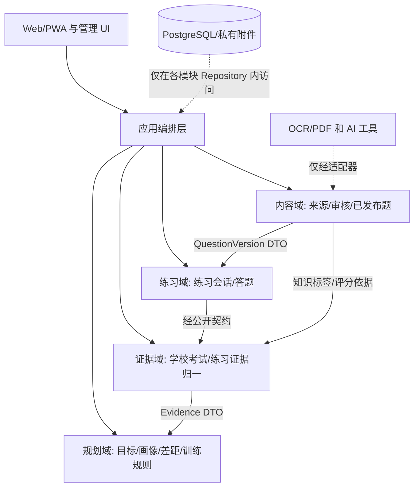

# 书童 V1.5：基于《软件程序设计原则》的二次复评与 V1.6 整改建议

> 文档类型：独立评估报告（**不是已批准的设计基线**）  
> 评估日期：2026-10-17  
> 评估对象：`书童-Docs-as-Code-V1.5/` 的 22 份现行页面、4 份历史归档、1 份候选 JSON Schema、2 个校验脚本、1 个 CI 工作流，以及 V1.6 前次建议。  
> 原则依据：[Blog4Jun《软件程序设计原则》（2018-11-24）](https://bigjun2017.github.io/2018/11/24/ruan-jian-she-ji/ruan-jian-cheng-xu-she-ji-yuan-ze/)  
> **结论范围：架构和文档工程评估，尚不能评价未实现代码是否真实满足 LSP/OCP 等原则。**

## 1. 执行摘要

**结论：有条件通过架构方向，暂不建议按全部 V1.5 设计一次性实现。**

建议保留：模块化单体、四科共用的题目/题组契约、真题来源与版权登记、独立不可变答题证据、学校试卷私有隔离、目标—现实差距—训练—未见题验证闭环、单机部署与异地备份。需优先修复：契约实际验证、Markdown 本地资源校验、重复权威规则、接口依赖方向和未经验证的大规模模型预设。

**二次评估的新结论：**“预先详细规划了太多模块”与“关键模块契约还不够明确”并不矛盾；应缩减推测性的未来功能，但加强已经被核心业务依赖的数据不变量和测试。

## 2. 逐原则矩阵

| 原则 | 方案状况 | 风险与实际证据 | 建议动作 |
|---|---|---|---|
| KISS | 需优化 | 文档层和预定数据表偏多；个人试用期缺最小纵切 | 聚焦一条可验证的学习闭环，删除纯管理负担 |
| DRY | 需优化 | GAP API 在 `gap-engine.md` 和 `tech-and-api.md` 重复；RPO 在 `runtime.md`、`disaster-recovery.md` 重述 | API、备份阈值、规则、验收各设唯一权威源，其余只链接 |
| 高内聚低耦合 | 部分符合 | 内容/学习/运维领域分离良好，模块间读取及写入边界未定义 | 领域模块只通过公开服务/API 与契约交互 |
| SoC 关注点分离 | 部分符合 | 业务设计页含数据库表和 HTTP 路径，易与 API 文档不一致 | 业务规则、输入输出契约、持久化、运维各归其位 |
| YAGNI | 重点优化 | 六维模型、多个画像/计划表、复杂状态机已详细设计，但尚无首个训练闭环运行证据 | 首版使用规则模型；完整等值、复杂调度、模型插件推迟 |
| Boy-Scout Rule | 尚待执行 | 已有 AGENTS/CI，但没有针对已知漏检的回归测试 | 发现的问题同 PR 修复，追加一个反例测试 |
| SRP | 部分符合 | 真题发布与学校卷私有证据核对职责不同 | 共用解析工具，不共用发布权限和审核流程 |
| LSP | 暂无法评价 | 尚无继承/抽象实现 | 不建四学科深继承树；若将来用多态，以替换性测试验收 |
| ISP | 需要完善 | 目前有 URL 清单，但缺可机器校验的请求/响应及不同权限消费者契约 | 先定义最小 `Practice`, `Evidence`, `Plan` 输入输出与错误码 |
| OCP | 风险待验证 | 未来想支持新题型、数据来源、评分策略 | 只为已知第二种实现提取策略接口，不提前做通用插件平台 |
| DIP | 重点优化 | `GAP Engine` 逻辑与数据库、AI、PDF/OCR 的依赖方向未写清楚 | 核心计算采用纯函数/稳定 DTO，基础设施在边界注入 |
| LoD 迪米特法则 | 存在风险 | 画像分析若直接读取题库/考试上传内部表，将造成跨模块内容耦合 | 通过 Evidence 查询接口获取必要信息，避免穿透式关联 |
| CRP 组合复用 | 基本正确 | 四学科及两类试卷来源存在共性和差异 | 用小策略函数组合渲染/评分/解析，业务权限保持独立 |

**补充原则：**

- 避免过早优化：未有真实数据和负载前，不使用分布式数据库、K8s、全文图数据库、多 Agent 编排、复杂预测模型。
- 最小惊讶：界面明确区分真实成绩、观察到的表现、模型推断和证据不足；自评题不能展示成教师确认分数。
- 为维护者写代码、信息隐藏：只有 `QuestionVersion`、`Evidence`、`Goal`、`Plan` 等最少领域概念需要成为公共词汇；隐藏 OCR、PostgreSQL、对象存储细节。
- 正交性：修改上传工具不能影响 GAP 算法；修改 GAP 计算规则不能重写历史答题；更换云主机不影响业务契约。
- 墨菲定律：保留异地备份、文件哈希、幂等提交和实际恢复演练，这些是已明确的数据风险控制，不属于无价值预设计。

## 3. 可复现审计发现

### F01｜P0｜契约校验误报通过

`contracts/source-manifest.schema.json` 声明 `exam_year` 必须为整数、URL 为 URI、日期符合格式；但 `scripts/check_contracts.py` 只核对字段存在、枚举和部分样本状态，没有使用 JSON Schema 的实际校验器。将示例 `exam_year` 改为字符串 `"2026"` 后，执行脚本仍输出 PASS 且退出码为 0。

**整改：**使用 `jsonschema.Draft202012Validator`（启用 format checker）验证 schema 和正例、反例；不使用 `assert` 充当 CI 正确性检查。保证错误类型、遗漏必填、无效日期、错误哈希、未授权状态都能导致明确失败。

### F02｜P0｜文档资源链接误报通过

`scripts/check_docs.py` 使用 `(?<!!)` 正则匹配普通 Markdown 链接，主动排除了图片链接。给 `docs/index.md` 添加 `` 后，检查仍 PASS。

**整改：**解析并校验本地链接、图片、文件引用及路径；持续执行 Zensical 严格构建；至少增加一个缺失图片的自动化反例测试。若采用成熟链接检查工具，避免在自研正则中持续堆例外。

### F03｜P0｜规范重复与变更漂移

- `docs/02-design/gap-engine.md` 与 `docs/04-engineering/tech-and-api.md` 同时列出 `/goals/current`、`/gaps`、`/plans/generate` 等接口。
- `docs/05-operations/runtime.md` 与 `docs/05-operations/disaster-recovery.md` 同时保有备份频率与 RPO/RTO 口径；`backup.md` 又定义具体调度与保留策略。
- 多份文档重复阐述验收及治理步骤。

**整改：**HTTP/JSON 由 `contracts/openapi.yaml` 管；运维阈值由 `backup-policy.md` 或结构化配置统一定义；恢复文档只描述操作步骤并引用目标；验收条件保存在唯一的 `acceptance.md`/可执行测试中。

### F04｜P1｜CI 范围不完整

`.github/workflows/docs-check.yml` 的 `paths` 未包括根目录 `AGENTS.md`、`README.md`、`CONTRIBUTING.md` 和 PR 模板。单独修改这些规则可能不触发检查。

**整改：**在此低流量个人项目中，删除 `paths` 过滤通常比持续维护白名单更符合 KISS；若有性能原因再使用维护良好的过滤器。

### F05｜P1｜候选模型被描述得像已稳定契约

`docs/03-data/data-model.md` 枚举了多个未来表；`docs/02-design/gap-engine.md` 包含六维画像、多版本对象、状态机及规划评分，但没有对应可运行数据/真实检验。

**整改：**标明 `proposed` 与“待验证假设”，当前仅约束 `QuestionVersion` 不可变、`AnswerAttempt` 可追溯、`Evidence` 有来源/独立性/审核状态、校卷个人隔离、独立评估题与训练题隔离这些稳定不变量。

## 4. 推荐业务边界和依赖方向

图示表达逻辑边界，不要求四个微服务；全部可以运行在同一个 FastAPI 进程中。`APP` 负责业务协调，不成为包含所有规则的上帝类。证据来源不可改写为模型结论；能力快照应始终可由保存的证据和算法版本追溯。

### 最小复用单元（需要时才抽取）

1. `AssetParser`：真题文件和学校试卷共用基础文本/图片处理；两类业务保留各自权限与审核流程。
2. `QuestionRenderer`：四学科通用题干/题组展示，特殊内容通过小组件组合。
3. `ScoringStrategy`：确定答案的客观题可以自动判分，开放题必须独立标注自评/人工评卷来源。
4. `EvidenceNormalizer`：练习作答与已核对学校题目级成绩映射为统一、可追溯的证据字段。只有总分的学校成绩**不能伪造成考点级证据**。
5. `GapAnalyzer`：输入相同评价口径的目标与现实画像，输出差距或证据不足；避免直接访问数据库或 OCR。

**依赖方向约束：**业务计算不依赖 FastAPI request、SQLAlchemy session、PDF 文件句柄或具体 AI SDK。让传输/存储/模型实现依赖领域输入输出，先用普通 Python 函数或 Protocol，不引入大型 IoC 框架。

## 5. V1.6 最小纵向实现范围

目标是在“四科数据契约统一”的前提下，以数学真实题目先走通流程，再逐科补差异：

1. 人工导入并审核一套合法获取的数学真题，建立不可变 `QuestionVersion`；
2. 一次练习作答，记录得分、耗时、提示、题目版本与幂等提交 ID；
3. 手工录入一份学校数学考试的分数和题目级已核对得分；若仅有总分，报告不能给出细考点结论；
4. 设定数学目标分及时间预算，依据同一知识标签建立可解释的目标与现实简化画像；
5. 规则比较：确认的短板 vs 证据不足；推荐下一步训练并解释原因；
6. 使用未训练的新题独立检验效果，更新证据并修订下一次计划；
7. 从异地备份在隔离环境重建数据库及关联试题/校卷附件。

**非目标：**不做全卷自动批改、未校准中考分数预测、多模型编排、AI 自主改写正式评分、复杂学习因果估计、社交/付费系统和商业级高可用。API、数据表和多态策略按首个可运行切片的真实用例逐步确定。

## 6. V1.6 Docs as Code 调整原则

不以文档文件数作为成功指标，而以“变更一个规则需要修改几个权威位置”“一个新人/Agent 能否找到当前权威定义”“文档错误是否能被 CI 拦住”来评价。

- `docs/product/`：目标、约束、验收目标；
- `docs/design/`：领域职责、不变量、业务流；
- `contracts/`：唯一机器可执行的请求/响应及核心 Schema；
- `docs/operations/`：部署、备份策略、恢复操作；
- `docs/quality/`：验收用例与实测证据；
- `docs/decisions/`：必要 ADR，解释难以从代码推断的决策；
- `legacy/`：只读历史，非当前权威；
- `AGENTS.md`：精简为 Codex 的变更范围、禁止事项和强制测试入口。

前端文档站点的生成是附带产物，Markdown/契约/测试才是权威。归档旧文档时保留指向新权威定义的迁移地图，不保留两个能同时修改的“最新版”。

## 7. 优先整改列表与可验证验收

| 优先级 | 行动 | 验收条件 |
|---|---|---|
| P0 | 真正运行 JSON Schema 类型/格式/枚举校验 | 错误类型、时间、URL、哈希等反例导致 CI 失败 |
| P0 | 修复 Markdown 图片与本地资源检查 | 缺失图片、错误相对路径、无效锚点按工具职责失败 |
| P0 | 确立接口与规则唯一权威 | 变更一个 API 字段只修改一份机器契约及相应测试 |
| P0 | 固化不可变题目、作答和证据追溯 | 编辑题目不改变历史作答；重试提交不重复入库 |
| P0 | 学校考试与真题来源隔离 | 私有校卷不能经题库发布接口泄漏；只有总分不生成考点证据 |
| P0 | 备份与恢复验收 | 在独立环境成功恢复数据库、附件及重要关联，记录实际 RPO/RTO |
| P1 | 删除 CI 触发遗漏，精简重复治理元数据 | 规则文件更改触发 CI；Git 版本是唯一时间权威 |
| P1 | 一个学科实现完整纵切 | 目标→记录→差距→练习→未见题验证可端到端运行 |
| P1 | 扩展四科专项差异 | 语文题组、英语阅读/音频、物理图示等经过真实题例测试 |
| P2 | 根据证据再引入更复杂模型 | 能说明新复杂度解决了已观察到的问题，且有基准测试 |

## 8. 关于原则冲突的裁决规则

- **DRY vs KISS：**第二次相似不必急于抽象；当真正重复的是规则/知识的权威定义时，应立即合并；仅相似的两段代码暂可并存。
- **OCP/DIP vs YAGNI：**仅为已经存在的可替换实现建立稳定小接口；不要为了未来十种 AI 后端创建十层抽象。
- **SRP/LoD vs KISS：**只划分真实变化原因与敏感权限边界；不要为每次方法调用都建立 Facade/Manager/Service 中介。
- **可恢复性 vs YAGNI：**数据无法再生且已有真实故障风险，因此可靠备份与恢复演练是当前需求，不是未来需求。
- **业务速度 vs 教育正确性：**即使效率更低，也不得把学校卷原始得分冒充成等值的中考能力分，或把训练题正确率直接作为学习迁移证据。

## 9. 总体建议

**下一阶段不是“完成所有设计书”，而是“通过七个必要用例证明一个可恢复、可解释、可维护的业务纵切”。**

先修两个已经证实的自动检查假阳性，再整理权威契约和依赖边界；保留核心数据保护措施；以单学科端到端实现对设计进行压力测试；之后再将相同基础能力复用到另外三科。原 V1.5 工程不在本报告中自动修改。

## 10. 证据与核查边界

- 外部原则：Blog4Jun，《软件程序设计原则》，2018-11-24，见文首 URL。
- 工程文件：`书童-Docs-as-Code-V1.5/` 下的 `docs/`、`scripts/`、`contracts/`、`.github/workflows/docs-check.yml`。
- 本次独立核验：原有 `check_docs.py`、`check_contracts.py` 均返回 PASS；临时副本中将 `exam_year` 修改为字符串，以及增加缺失图片引用后，也均错误返回 PASS（退出码 0）。
- 尚未验证：真实应用源代码（尚未提供）、GitHub Actions 线上构建、真实恢复演练、学习算法效果；不对这些未验证部分给出“已符合”结论。
