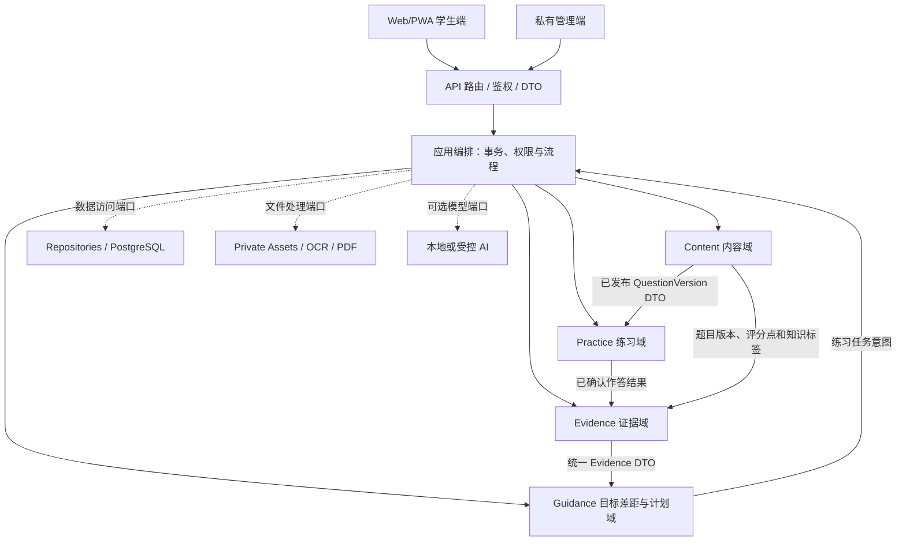
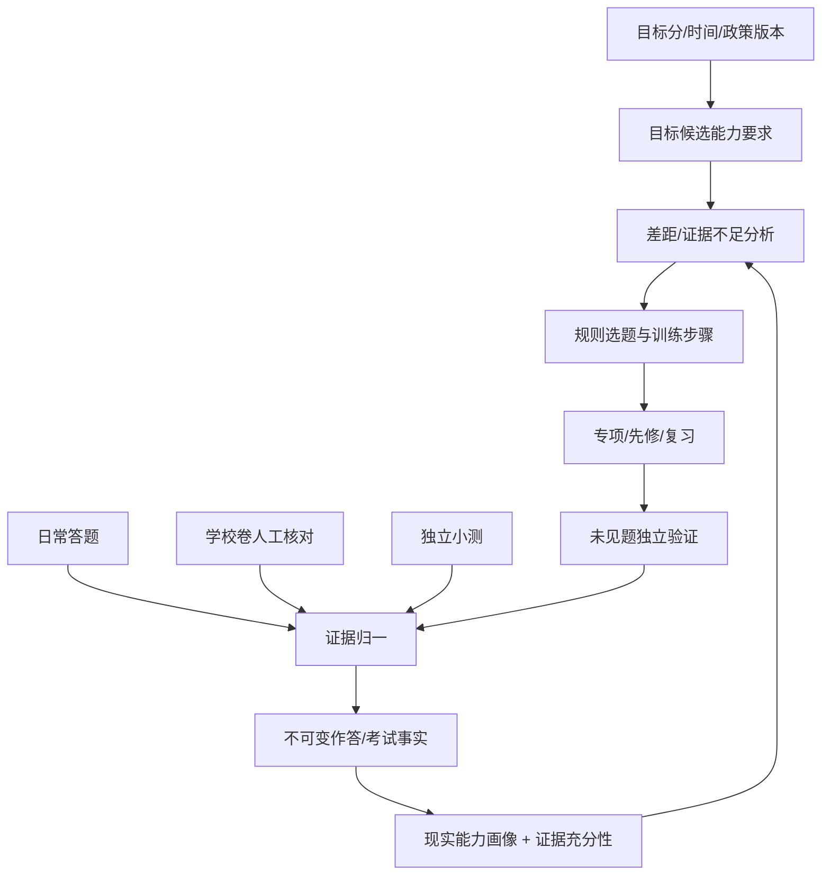

# 书童（ShuTong）V1.6｜优化设计方案

> 状态：**拟议设计基线（Proposed）**，供评审、确认及 V1.5 → V1.6 实施使用；不代表 V1.5 工程已自动重构或系统已完成部署。  
> 制定日期：2026-10-17  
> 输入：V1.4 产品及灾备方案、V1.5 Docs as Code 工程、V1.5 两次设计原则评估报告  
> 目标：个人非商业、初三冲刺、语文/数学/英语/物理、Web/PWA、可信真题与学校考试证据、目标差距驱动学习  
> 原则参考：[Blog4Jun《软件程序设计原则》](https://bigjun2017.github.io/2018/11/24/ruan-jian-she-ji/ruan-jian-cheng-xu-she-ji-yuan-ze/)

---

## 0. 执行摘要与版本定位

### 0.1 一句话定位

**书童 = 真题资源治理 + 可信学习证据 + 目标/现实能力差距分析 + 自适应练习 + 未见题复测的闭环学习系统。**

V1.6 是架构收敛版本，而不是功能堆叠版本。以能够被验证、能够恢复、能够安全迭代的「单学科端到端纵切」证明方案可行，再复用到其他三科。

### 0.2 核心调整

| 领域 | V1.5主要风险 | V1.6正式建议 | 设计原则 |
|---|---|---|---|
| 业务模块 | 服务名过多、调用方向不清 | 四个领域边界 + 轻量编排层 | SRP、SoC、低耦合 |
| 数据 | 事实、画像、推荐日志可能重复保存结论 | 原始记录唯一事实源；画像作为可重算派生结果 | DRY、正交性 |
| 目标画像 | 预先设计复杂「分数反推六维能力」 | 先输出候选能力要求和证据不足，不伪造等值分 | KISS、最小惊讶 |
| GAP Engine | 未经验证的复杂权重/状态机 | 规则 + 解释 + 独立复测反馈；纯函数优先 | YAGNI、DIP |
| 多科实现 | 易建立庞大题型类层次 | 共享题组/作答框架，已出现差异再组合策略 | CRP、OCP、LSP |
| 真题/校卷 | 容易混用处理流 | 共享文件处理能力，隔离审核、许可与权限 | SRP、ISP |
| 文档 | 同一接口/阈值/验收定义分散 | 契约、业务规则、备份阈值、测试分别只有一个权威位置 | DRY |
| 检查 | JSON 合法性/图片资源可误报 PASS | 标准 Schema 实际验证 + 链接检查正反例 + CI 严格构建 | 童子军规则 |
| 运行 | 灾备规范较丰富，目标未经实测 | 保留单节点/异地备份/真实恢复；延迟企业级高可用 | KISS、墨菲定律 |

### 0.3 三个成功判断

1. **最少改变**：更换 OCR / 数据库连接实现，不改 GAP 计算核心；修改选题规则，不改学校卷导入。
2. **证据可信**：任何诊断都能回溯到题目版本、评分来源、是否独立答题以及算法版本；证据不足时明确显示未知。
3. **真正可恢复**：从独立异地备份恢复数据库和附件后，既能查真题，也能重放答题并重建画像与计划。

---

## 1. 范围、非目标、约束

### 1.1 确定范围

- 用户：北京市初三中考冲刺学生；首阶段个人使用/受控小范围验证。
- 科目：语文、数学、英语、物理；四科共享数据契约，先完成数学业务纵切再完成其余三科题型适配。
- 终端：响应式 Web + PWA；离线仅承诺已明确实现并测试的有限能力。
- 输入：可合法取得的历年真题、人工核对的学校考试分数/试卷、日常练习、独立复测。
- 输出：目标条件、基于证据的现实表现、能力差距/证据缺口、可执行训练步骤及复测结果。
- 运行：私有单节点服务可长期访问，本地 Ubuntu 可承担辅助内容处理；核心学习数据异地加密备份。

### 1.2 当前明确非目标

商业付费/多租户平台、自动全网爬取、未经授权的真题公开分发、全部主观题 AI 自动评分、未经校准的中考分数预测、完整听说机考和实验操作模拟、教师/学校正式成绩认证、多 Agent 编排、Neo4j/Kafka/K8s/双活、复杂学习因果推断。

### 1.3 不可妥协的业务不变量

**INV-01**：未审核或缺来源合规状态的题目不得进入正式练习。  
**INV-02**：一经引用的 `QuestionVersion` 不可覆盖；更正产生新版本。  
**INV-03**：每次作答记录引用确切题目版本；同一个客户端幂等键最多产生一次有效提交。  
**INV-04**：原始成绩、教师确认评分、机器识别、自评和模型推断必须显式区分。  
**INV-05**：只有学校考试总分时，不生成虚构的知识点级得分证据。  
**INV-06**：训练题与独立效果验证题在同一学生维度隔离；看过的题不再称为「未见题」。  
**INV-07**：学校试卷、学生答题及个人画像不可通过公共真题发布/检索路径泄露。  
**INV-08**：无数据或低可信数据不能当成零能力；不同考试的原始分数不未经校准直接等值。  
**INV-09**：产生画像、差距、计划的算法版本与输入证据范围可追溯；旧结论不因新版本发布而被静默改写。  
**INV-10**：生产学习记录与关联附件须能从异地备份联合恢复；没有演练不得宣称达到 RPO/RTO。

---

## 2. 面向变化原因的模块设计

### 2.1 总体架构（一个后端进程，四个业务领域）



虚线表示基础设施适配器调用；不表示业务逻辑直接依赖 PostgreSQL、文件句柄或 AI SDK。**四个业务域属于同一个模块化单体，不是四个微服务。**

### 2.2 边界、职责、禁止事项

| 领域 | 独立变化原因 | 最小公开能力 | 禁止事项 |
|---|---|---|---|
| `content` | 真题来源、规范、解析与审核变化 | 查询已发布题目版本、标签与评分依据；导入/审核/发布命令 | 不保存学生学校试卷；不计算学习能力 |
| `practice` | 答题交互、评分方式、练习会话变化 | 创建练习、记录作答、输出评分事实 | 不直接写画像分数；不发布真题 |
| `evidence` | 证据可信度、校卷核对、来源规则变化 | 归一练习/校卷/测评事实、按条件提供 Evidence DTO | 不决定训练计划；不把 OCR 草稿当教师评分 |
| `guidance` | 目标、画像、差距、规则选题变化 | `build_profile`、`analyze_gap`、`plan_next`、`evaluate` | 不读取 OCR 文件、不直接操作 SQLAlchemy Session |
| 应用编排（非业务域） | 跨模块事务/权限与用例变化 | 组织调用、检查权限、持久化结果 | 不实现第二份评分或推荐算法 |

**跨域写入规则**：不得直接修改其他领域的表和 ORM 对象；经应用层调用公开命令或获取 DTO。初期可使用同一数据库事务和函数调用，无需事件总线。

### 2.3 依赖倒置实现边界

- `guidance` 的算法入口接收普通 Python 数据对象，返回结果对象；不导入 `FastAPI`、`SQLAlchemy`、OCR、AI SDK。
- 基础设施通过 `repositories`、`asset_store`、`document_parser` 等**已有真实替代需求时**的小接口接入；不用通用插件系统或重量级 IoC 框架。
- 应用层注入所需适配器；单元测试注入内存数据/固定测试输入。
- UI 通过 OpenAPI 契约与后端交互，不直接依赖数据库字段。

### 2.4 组合优于继承的两个复用边界

**文件处理组合：** `文件登记/哈希` + `基础图文提取` + `题目结构解析`。真题随后进入审核发布流程；学校试卷随后进入私人核对、评分确认证据流程。两者不得共享「发布」命令。

**多学科练习组合：** 通用 `题组渲染 + 答题记录 + 已审评分规则 + 证据归一`，只为已存在的科目差异组合 `公式/图形渲染`、`阅读题组展示`、`音频资源` 和 `开放题自评` 等局部能力。不要建立 `BaseExamQuestion → SubjectQuestion → SpecificQuestion` 深继承树。

---

## 3. 数据权威性与最小领域模型

### 3.1 一份信息，只保留一个权威事实源

| 信息 | 唯一事实源 | 可重算/缓存对象 | 必须保留的引用 |
|---|---|---|---|
| 真题正文 | 不可变 `question_versions` | 查询索引/展示视图 | 来源、资产、审核记录、版本 |
| 原卷与附件 | 内容哈希标识的私有文件 | 缩略图/OCR 产物 | 文件哈希、访问域、权利状态 |
| 一次练习 | `answer_attempts` | 错题统计、习题表现 | 用户、题目版本、时间、评分来源 |
| 学校考试 | `school_exams` + 已确认得分明细 | 校卷知识点映射/图表 | 考试类型、总分/满分、核对状态 |
| 目标条件 | 版本化 `goals` | 目标候选画像 | 政策/蓝图版本、用户确认 |
| 学习证据 | 从作答/校卷/独立复测映射的 `Evidence` 统一视图 | 归一化缓存（如有） | 源事件 ID、证据规则版本 |
| 实际能力 | 基于 Evidence 的计算结果 | `profile_snapshot`（可选） | 输入截止点、算法版本、可比性 |
| 差距与计划 | 基于目标、画像和约束的结果 | 当前执行计划（可持久化） | 输入版本、推荐理由、验证标准 |

如选择额外物化 `evidence_records`，它只能是来源事件可追溯且可重建的投影，不得成为第二套可人工修改的成绩事实。画像/计划不是「真实考试成绩」。

### 3.2 首个纵切必须的数据实体

| 实体 | 目的 | 核心约束 |
|---|---|---|
| `source_documents` | 真题原卷的来源、权利与文件清单 | 来源/下载状态/权限不可省略 |
| `assets` | 文件、图片、附件 | 内容哈希，学校附件私人 ACL |
| `questions` / `question_versions` | 题目身份与不可变内容 | 版本唯一；发布不可覆盖 |
| `knowledge_points` / `question_knowledge` | 知识标签与关系 | 受版本管理，不重复计综合题分值 |
| `practice_sessions` / `answer_attempts` | 一次练习与提交 | `(learner_id, client_attempt_id)` 唯一，引用题目版本 |
| `school_exams` / `school_exam_scores` | 学校考试及人工确认分数 | 仅总分允许；题号得分可为空但不可伪造 |
| `goals` | 目标及时间预算 | 修订创建新版本 |
| `plan_runs` / `plan_steps` | 当期安排及执行结果 | 理由、证据引用、评估触发条件 |

> 这是**最小逻辑模型**，不是要求立即建立一张一一对应的表。需要存储的字段和物理拆分必须以第一个真实纵切为依据。后续扩展学科可新增专属内容结构，但不可破坏通用题目与答题协议。

### 3.3 `Evidence` 统一输入契约（候选 DTO）

```json
{
  "source_event_id": "attempt:example-001",
  "learner_id": "private-user-1",
  "subject": "math",
  "knowledge_id": "math.function.quadratic",
  "question_version_id": "qv-example-3",
  "source_type": "practice",
  "earned_points": 3,
  "max_points": 5,
  "scoring_origin": "reviewed_answer_key",
  "independence": "no_hints_unseen",
  "exam_context": "untimed_practice",
  "observed_at": "2026-10-17T09:00:00Z",
  "taxonomy_version": "tax-v1",
  "evidence_rule_version": "ev-v1"
}
```

**注意：**示例是假数据，不是已定稿 Schema；字段必须在 V1.6 `contracts/` 单处定义。`earned_points/max_points` 必须同时存在且边界合法；含多个知识点的综合题若没有分步采分点证据，不能把全部得分复制给每个知识点。没有可核对评分的自评题必须标记低可信来源或仅作定性记录。

### 3.4 数据缺失与口径规则

- 只有学校试卷总分 → 保存总分与考试信息，进入趋势报告，**不进入知识点级 Evidence**。
- 未做过知识点 → `UNKNOWN/UNOBSERVED`，不能记为0分或低掌握度。
- 学校考试与中考真题 → 分开显示原卷表现；无法等值时不相减，不提供虚构的预测中考分数。
- 提示后答对 → 记录为有提示表现，不能自动作为独立掌握证据。
- 复习原题答对 → 可以说明保持或熟悉度，不得作为未见题迁移成功的证据。
- 学生目标总分只说明意图；未纳入训练的科目、听说和实验部分应标记未覆盖，不能靠笔试数据补全。

---

## 4. 两条业务工作流

### 4.1 真题资源治理


- 原卷一律保留文件校验和与来源信息。
- AI/OCR 提取结果默认为草稿，只能进入人工审核界面。
- 题目须保存题组、图片、公式、采分点和现行考试适用性。
- 内容修正后产生新题版本，不静默改写历史作答。
- 学校私人试卷即使与公开真题重复，也不自动获得公开传播权或进入题库发布流。

### 4.2 目标差距与自适应提升



#### 4.2.1 目标能力画像（小而诚实）

输入：考试政策版本、科目分数目标、已确认的考试蓝图、学习时长、剩余天数。输出：**需要争取的题型/知识能力和候选得分机会**，其数值来自明确的试卷结构假设，不把一个分数目标硬反推成唯一知识掌握度。初期只启用数学对应的能力要求计算，其他科目可先存目标与蓝图等待适配。

#### 4.2.2 现实能力画像（事实与估计分离）

对每个考点保存/展示：有效独立答题题数、评分来源、观察得分率、提示依赖、最近测试时间、是否已覆盖、证据可信等级；必要时额外展示限时表现和迁移表现。**初版不强制做六维综合分数。**

#### 4.2.3 GAP 分类及动作

| GAP 类型 | 判定依据 | 行动 |
|---|---|---|
| `INSUFFICIENT_EVIDENCE` | 同口径新题不足、评分来源低可信 | 先安排小型诊断 |
| `KNOWLEDGE_GAP` | 多次有效题显示特定基础考点薄弱 | 补前置知识与基础训练 |
| `METHOD_GAP` | 基础知识尚可，特定解题方法持续失误 | 方法辨析、分步训练 |
| `SPEED_GAP` | 正确但在可比限时条件下耗时过长 | 限时题组、路径优化 |
| `TRANSFER_GAP` | 训练题可做、未见变式失败 | 新情境迁移训练 |
| `NO_CONFIRMED_GAP` | 数据不足以确认提升优先级或已达本阶段标准 | 保持/低频复测/测其他考点 |

#### 4.2.4 初期优先级规则

**先判断证据能否用于比较，再排序。** 对已证实短板，使用可解释启发式：考试相关性、相对差距、前置依赖、时间成本、预计可训练性。示例评分权重只能作为配置/待测假设，不能在文档里宣称已学术验证。按 5/10/15/20/30 分钟预算选题，避免长期计划每题波动。

#### 4.2.5 计划调整机制

- 新增一份有题目级确认的校卷；
- 完成未见题独立验证；
- 当前考点连续失败或出现明显提示依赖；
- 用户调整目标/可用时长；
- 定期复盘。

训练内的即时反馈只轻量调整下一题；计划级重排采用一次测评完成/阶段边界等明确触发，避免推荐震荡。

#### 4.2.6 评估成立的必要条件

1. 验证题之前未向同一学生曝光，且不属于用于本次训练的题目；
2. 验证与基线至少有相近知识点、难度/题型及评分规则；
3. 记录限时条件、提示使用、样本量、分母和题目版本；
4. 题目不足或不可比则报告「目前无法判断」，不输出虚假涨分；
5. 评估结果关联所采用的计划版本、训练步骤和算法版本。

---

## 5. 最小接口与契约治理

### 5.1 契约单一事实源

- `contracts/openapi.yaml`：HTTP 路由、请求/响应、错误码、鉴权。
- `contracts/schemas/*.json`：题目来源、题目版本、评分事实、Evidence、Goal 等 JSON Schema。
- `docs/design/`：业务规则、状态边界、算法语义和原因，**不重复维护完整接口字段表**。
- `docs/quality/acceptance.md` 与 `tests/`：测试场景、判据和执行命令，业务文档只链接。
- `docs/operations/backup-policy.md`：唯一 RPO/RTO 目标、频率、保留周期；恢复手册引用，不复制数值。

在对应功能实际实现时再将候选 DTO 固化成机器可验证契约；未实施 API 不应伪装成已稳定发布接口。

### 5.2 第一个纵切只实现必要用例

| 用例 | 入口意图 | 结果 | 初期验证 |
|---|---|---|---|
| U01 | 导入并审核真题 | `QuestionVersion` 发布 | 未审核不可查询 |
| U02 | 创建练习并提交作答 | 不可变答题事实 | 幂等及版本引用 |
| U03 | 录入学校成绩 | 已确认的成绩事实 | 总分≠知识点证据 |
| U04 | 设定科目目标 | 有版本的 Goal | 修改可追溯 |
| U05 | 查询画像与差距 | 可解释的不足/未知项 | 缺证据不臆测 |
| U06 | 生成下一训练步骤 | 含原因与验证条件的计划 | 策略纯函数单测 |
| U07 | 完成未见题验证 | 新证据和后续计划 | 不复用已曝光题 |
| U08 | 异地恢复 | DB + 附件 + 应用可用 | 隔离环境真实重建 |

先按这 8 个用例设计 OpenAPI，避免一开始维护十余个推测性的路径。

### 5.3 约定示例（设计指引，非已发布接口）

- 每个可重试的写请求携带 `Idempotency-Key` 或业务幂等键，服务端在用户范围内保证唯一。
- 错误以稳定机器码表示，例如 `QUESTION_NOT_PUBLISHED`、`SCORE_NOT_CONFIRMED`、`INSUFFICIENT_EVIDENCE`、`EVALUATION_ITEM_EXPOSED`。
- 读结果包含 `model_version`、`evidence_cutoff`、`uncertainty` 或明确的 `cannot_estimate_reason`（当该结果是派生推断时）。
- 对外响应只暴露最小业务 DTO，不暴露私有文件的磁盘路径、原始库表或内部 ORM 模型。

---

## 6. Docs as Code V1.6 目标树与权威边界

```text
shutong/
├── README.md                      # 只包含项目入口/启动与文档索引
├── AGENTS.md                      # Codex/Agent 最少强制约束
├── CONTRIBUTING.md                # 人类贡献流程，避免复制 AGENTS 全文
├── docs/
│   ├── index.md
│   ├── product/
│   │   ├── overview.md           # 用户、价值、范围、非目标
│   │   └── milestones.md         # 阶段与交付目标
│   ├── design/
│   │   ├── architecture.md       # 领域边界、依赖方向
│   │   ├── ingestion.md          # 真题解析/审核/发布
│   │   ├── learning-loop.md      # 目标/现实/差距/训练/复测
│   │   └── data-model.md         # 数据不变量、单一事实源
│   ├── engineering/
│   │   └── interfaces.md         # 引用机器契约；不重复字段
│   ├── operations/
│   │   ├── deployment.md         # 部署与监测
│   │   ├── backup-policy.md      # 唯一 RPO/RTO 与备份周期定义
│   │   └── recovery-runbook.md   # 故障处置步骤与演练
│   ├── quality/
│   │   └── acceptance.md         # 唯一验收索引
│   └── decisions/               # 发生实质架构决定才增加 ADR
├── contracts/
│   ├── openapi.yaml              # 接口的唯一权威契约（逐步补全）
│   └── schemas/                 # 结构化对象与格式校验
├── tests/                        # 契约、模块、端到端、灾备检查
├── scripts/                      # 工程自动检查
├── .github/workflows/            # CI，默认不限制文件路径触发
├── legacy/                       # V1.2—V1.5 的只读历史材料
└── zensical.toml
```

**这个目录树是 V1.6 目标结构，不代表目录已实际迁移。** 不以「必须有 12 份」等页数目标驱动重构；确有不同维护责任时可再拆。历史文件须先经过迁移核对再只读归档，不能把旧版和新版同时标记为权威。

### 6.1 文档最小治理规范

1. 每份现行文档一处一级标题；可选前置元数据保留 `status` 和稳定 ID（仅在实际需要交叉索引的文件），更新时间由 Git 确定。
2. 变更接口只改机器契约及对应测试；变更业务规则只改归属设计文档并更新测试；摘要可以链接，不抄权威字段。
3. ADR 仅记录重要且难以从代码直接看出的决策及权衡，非每次重命名都需 ADR。
4. `AGENTS.md` 约束 Agent 的权限、修改范围、必跑测试、禁止把学生数据和原卷提交至仓库；不重复长篇产品规范。
5. 数据 Schema / API 与文档版本使用同一 Git 提交评审，不维护两套独立发布时间表。

### 6.2 文档校验的真实修复标准

- 使用 `jsonschema` 的 Draft 2020-12 验证器真正校验字段类型、必填、格式、枚举、禁止额外字段；`format` 检查显式启用，URL 的「可访问」不等同于 Schema 格式合法。
- 在正例外增加反例：`exam_year` 字符串、无效日期、损坏 SHA-256、错误权限状态、缺失必填；反例**必须失败**。
- Markdown 链接检查覆盖相对链接、图片引用、路径逃逸；本地资源必须存在；站点构建严格模式检查锚点与导航。
- CI 不使用容易漏掉根目录规则文件的路径白名单；在 PR 和主分支 push 运行。
- 使用可维护的解析器/成熟工具，避免对 Markdown 链接不断添加复杂正则。
- 若构建依赖未在本地可用，应明确报告「未执行」，不能把脚本通过描述为完整 CI 已验证。

---

## 7. 稳定运行与灾备：保留真正必要的复杂度

### 7.1 推荐部署

- 一台私有 Ubuntu LTS 主运行节点：PWA 静态资源、FastAPI、PostgreSQL、受控附件目录；Docker Compose 管理服务。
- 本地 Ubuntu 辅助任务：真题解析、OCR、可选本地 AI；执行后将**审核结果**受控同步，不与在线事务强耦合。
- 私有 HTTPS 访问与身份验证；暂不建设公网商业 SaaS 访问面。
- 独立异地加密备份仓库和另一故障域的恢复副本；访问权限与生产应用账户隔离。

### 7.2 关键运行约束

- 服务健康检查、主机重启自启动、数据库持久化、版本固定、幂等写入、必要指标与告警。
- 备份必须协调数据库快照与被引用的不可变附件；备份清单包含数据库、附件、版本/哈希与应用迁移信息。
- 仅拥有 `pg_dump` 的数据库备份不能宣称具有 WAL/PITR 能力。
- 全量恢复先在隔离环境进行，误删一题优先细粒度恢复而不是覆盖整库。

### 7.3 当前恢复目标和证实条件

沿用 V1.4 **候选目标**：核心学习数据每 4 小时协调备份，RPO ≤6 小时；常见故障 RTO ≤4 小时，跨主机恢复先按 4—8 小时演练目标评估。所有值的**唯一权威来源**在迁移完成后是 `docs/operations/backup-policy.md`；本节只是提出沿用，不应作为第二套长期权威规范。首次隔离恢复演练未完成之前，所有目标状态为 `unverified`。

新增硬条件：备份上传成功、附件哈希可验、恢复凭据离线可得、隔离恢复后能够检索真题并重建学习证据及计划。暂不做多机双活、自动切主、Kubernetes 或未经需求验证的 PITR。

---

## 8. 开发分期：八个可验证用例优先于工期数字

### 8.1 里程碑与准入条件

| 阶段 | 交付 | 退出门槛 | 主要风险 |
|---|---|---|---|
| P0-A 基线校验 | V1.5 归档、V1.6 规范、CI 修正 | 正反例测试及文档构建实际通过 | 错误 PASS 误导开发 |
| P0-B 题库纵切 | 来源、图文解析、审核发布 | 真实合法样题可查；未审核不可查 | 图片、答案、许可错误 |
| P0-C 练习证据 | 数学答题记录、幂等提交、复练 | 记录可重放；编辑题目不污染历史 | 重复提交、版本漂移 |
| P1-A 学校卷证据 | 手工录分与核对，细项得分可选 | 总分不能生成考点证据；校卷私有 | 错误 OCR、信息泄露 |
| P1-B GAP 纵切 | 目标、现实、差距、规则计划 | 有根据的建议；不足时先诊断 | 伪精确推断 |
| P1-C 独立验证 | 未见题复测与计划调整 | 可重算，并显示不能判断的情况 | 泄题、统计偏差 |
| P1-D 四科复用 | 题组、公式、音频/图示、开放题自评 | 每科代表性题目及特殊形式通过 | 共享组件过度抽象 |
| P0-OPS 恢复门禁 | 异地备份及新环境恢复 | DB + 文件引用一致，实际 RPO/RTO 被记录 | 不可恢复的数据损失 |

`P0-OPS` 与数据持久化阶段并行推进，且必须在任何真实长期学习数据积累前完成，不应排在所有功能做完之后。

### 8.2 优先关闭的确定性技术债

| 编号 | 问题 | 优先级 | 具体修复验收 |
|---|---|---|---|
| F01 | JSON Schema 校验假阳性 | P0 | 错类型/日期/哈希/权限反例失败，合法例通过 |
| F02 | Markdown 图片缺失假阳性 | P0 | 新增断链图片导致本地与 CI 检查失败 |
| F03 | API/验收/灾备规则重复 | P0 | 每个规则可指出唯一权威文件，其余引用 |
| F04 | CI 路径过滤遗漏 | P0 | AGENTS/CONTRIBUTING/README 单独变动亦触发 CI |
| F05 | 候选模型被当成稳定协议 | P1 | 候选/已定稿/已实现三种状态显式区分 |
| F06 | 过重的文档治理元数据 | P1 | 移除可由 Git 推导的冗余人工字段 |
| F07 | 学校卷与题库处理权限混合风险 | P0 | 私有卷不存在题库发布接口；隔离权限负面测试 |
| F08 | 派生画像与成绩双事实风险 | P0 | 相同输入和算法版本可重算相同诊断结果 |

---

## 9. 关键验收矩阵（设计即测试）

| 验收 ID | 类型 | 输入/操作 | 必须满足的结果 |
|---|---|---|---|
| AC-DOC-01 | 质量 | 源清单 `exam_year="2026"` | JSON Schema 校验失败 |
| AC-DOC-02 | 质量 | 文档新增不存在的图片 | 本地检查失败；CI 阻断 |
| AC-DOC-03 | 质量 | 只修改 `AGENTS.md` | 文档 CI 触发 |
| AC-CNT-01 | 内容 | 尝试发布未审核题 | 阻止，并给可解释错误 |
| AC-CNT-02 | 内容 | 编辑已被引用的已发布题 | 新建版本，历史作答内容不变 |
| AC-PRC-01 | 练习 | 同一用户重复提交相同幂等键 | 不新增第二条作答 |
| AC-EVI-01 | 证据 | 仅导入学校考试总分 | 只显示考试表现，不产生考点证据 |
| AC-EVI-02 | 证据 | OCR 尚未人工核对的校卷 | 不进入教师确认评分证据 |
| AC-GAP-01 | 画像 | 没有独立题证据 | 返回 `INSUFFICIENT_EVIDENCE`，不显示零能力 |
| AC-GAP-02 | 架构 | 替换 OCR 实现 | `guidance` 单元测试不变、逻辑不依赖解析器 |
| AC-GAP-03 | 算法 | 调整推荐规则 | 旧 AnswerAttempt 不变，可用旧算法版本重放 |
| AC-VAL-01 | 效果 | 复测题学生曾看过 | 不能标记为「未见题验证」 |
| AC-VAL-02 | 效果 | 无同口径可比题 | 显示「无法判断」，不输出涨分 |
| AC-SEC-01 | 权限 | 用题库接口猜学校附件 ID | 返回拒绝/不可见，不泄露 |
| AC-OPS-01 | 灾备 | 主节点全损模拟 | 从异地副本在新环境恢复 DB+附件并完成冒烟测试 |
| AC-OPS-02 | 灾备 | 异地上传失败 | 备份状态失败，触发告警，不算成功快照 |

每条验收必须对应真实测试脚本、手动恢复证据或明确的未完成状态；不得仅凭设计文档勾选通过。

---

## 10. 迁移策略：V1.5 → V1.6（不丢知识、不双重维护）

### 10.1 先冻结并留痕

1. 保留 V1.5 ZIP 和原目录；建立 Git Tag `docs-v1.5`（仅作为建议操作，不宣称已创建）。
2. 将两份评估报告作为只读依据，登记 F01–F08 与对应变更任务。
3. 每迁一页先识别其**唯一权威信息**，更新所有相关链接，再把旧页移入 `legacy/`。

### 10.2 迁移映射

| V1.5 来源 | V1.6 目标 | 迁移方式 |
|---|---|---|
| `01-product/positioning.md`、`roadmap.md` | `product/overview.md`、`milestones.md` | 去掉重复验收条款，引用质量页 |
| `02-design/system-architecture.md` | `design/architecture.md` | 收敛四域及依赖方向 |
| `02-design/question-ingestion.md` | `design/ingestion.md` | 共享解析与分离权限 |
| `02-design/gap-engine.md`、`practice-loop.md` | `design/learning-loop.md` | 统一两类画像与证据闭环，移除重复 API 清单 |
| `03-data/data-model.md` | `design/data-model.md` | 必要不变量 + 最小实体，未来表标 `proposed` |
| `03-data/provenance-and-privacy.md` | `design/ingestion.md` + `design/data-model.md` | 版权及校卷隐私归口；不复制相同条款 |
| `04-engineering/tech-and-api.md`、`contracts.md` | `engineering/interfaces.md` + `contracts/` | OpenAPI/Schema 唯一事实源 |
| `05-operations/runtime.md` | `operations/deployment.md` | 仅环境、访问、运行诊断 |
| `05-operations/backup.md` | `operations/backup-policy.md` | 唯一 RPO/RTO、调度、保留策略 |
| `05-operations/disaster-recovery.md` | `operations/recovery-runbook.md` | 只保留恢复操作及验收引用 |
| `06-quality/acceptance.md` | `quality/acceptance.md` | 唯一验收 ID 索引及真实测试链接 |
| `00-governance/*` | 精简到 `AGENTS.md`、`CONTRIBUTING.md` 和必要 ADR | 旧迁移表/追溯表归档，不多头维护 |

### 10.3 迁移完成标准

- 不存在两份「当前生效」的重复业务/接口/备份规则。
- 所有 V1.5 的重要事实、许可边界、隐私约束、四科范围、学习闭环和恢复约束均可在新结构找到。
- 全部文档链接和契约实际验证通过；变更能从 Git diff 审阅。
- 任何还未实现的功能使用 `proposed`/`not implemented` 标识，不因文档完成误认为代码已交付。

---

## 11. 各设计原则的裁决与反模式

| 原则冲突 | 裁决 | 具体例子 |
|---|---|---|
| DRY vs KISS | **去重重复的业务知识**，不必见到两段相似代码就抽象 | RPO 只在 backup-policy 一处定义，运行页只引用 |
| OCP/DIP vs YAGNI | 先有真实第二种策略，再提取窄接口 | 先用一个评分函数；出现开放题再组合自评策略 |
| SRP/LoD vs KISS | 按不同变化原因、权限和不变量拆分，不为每次调用建 Manager | 校卷私有证据与真题发布必须分域 |
| CRP vs LSP | 优先组合，若确有多态则以同一契约替换性测试验收 | 四科渲染不建深继承树 |
| 学习效果 vs 快速上线 | 先保证校卷分数、独立验证和能力推断不混淆 | 没有可比验证题就提示不足以判断 |
| 备份 vs YAGNI | 真正难以重建的数据必须现在保护；高级高可用推迟 | 异地备份必要，双活集群非必要 |
| 设计全面性 vs 尽快交付 | 保留业务目标，按纵向用例逐步实现 | 先贯通数学，再落地四学科差异 |

明确禁止的反模式：**上帝服务（万能 Engine）、重复权威 DTO、跨模块直接操作 ORM、六维数值伪精确、OCR 草稿自动入正式成绩、训练题自证进步、无恢复演练的“备份可用”、为尚不存在的插件开发平台。**

---

## 12. 决策待验证项与下一步

### 12.1 待验证，而非必需立即提问

- 第一批真实试卷可合法获取的数量和图片/公式复杂度，影响解析器选择。
- 学校试卷能否取得题目级确认得分，影响知识点级现实画像覆盖。
- 用户是否需要外网随时访问，决定云主机是否立即购买；单机本地方案同样可按本规范开始。
- 未见题池的规模及知识点覆盖，决定能否频繁做迁移验证。
- 真实恢复测试的耗时和备份增长量，决定是否调整备份频率与容量。

### 12.2 建议的第一个 Codex 交付包

**任务包：`ST-V16-FOUNDATION`**

1. 创建 V1.5 只读基线与 V1.6 设计目录；
2. 修复 F01、F02、F04，并将反例加到测试；
3. 明确最小 `QuestionVersion`、`AnswerAttempt`、`Evidence` 契约；
4. 制作一个有图片/公式的数学真题样本，完成入库→审核→作答→证据链；
5. 对已有学习证据实现最小目标差距、规则推荐与未见题复测；
6. 完成独立异地备份的最小恢复演练。

**成功定义：**不是写完多少代码，而是该任务包的验收案例全部实际通过，错误输入明确失败，并能够从新主机恢复这条最小学习业务闭环。

---

## 附录 A：参考与证据边界

1. 本设计依据项目已有材料：`书童-整体设计方案-V1.4.md`、`书童-Docs-as-Code-V1.5.zip`、`书童-V1.5-设计原则评估及V1.6精简重构建议.md`、`书童-V1.5-基于软件设计原则的二次复评与V1.6整改建议.md`。
2. 原则解释依据：[Blog4Jun 软件程序设计原则](https://bigjun2017.github.io/2018/11/24/ruan-jian-she-ji/ruan-jian-cheng-xu-she-ji-yuan-ze/)；它属于设计原则介绍性文章，不构成对书童实现质量的独立证明。
3. 目前确认的 F01/F02 等缺陷来自先前对 V1.5 校验脚本的实际负向试验；此文档仅规划修复，不声称已完成。
4. 尚未验证：未来应用功能、真实在线 CI、Zensical 全量构建、学习推荐效果、实际 VPS 容量和灾备恢复时长。

## 附录 B：版本变更摘要

- V1.4：产品、双画像、四科真题、真题导入、稳定运行与灾备概念整合。
- V1.5：Docs as Code 工程骨架、Schema 候选和基础 CI。
- **V1.6 Proposed：**领域收敛、统一权威契约、证据事实源、自适应闭环最小实现、验证与恢复硬门禁、文档和工程迁移计划。
