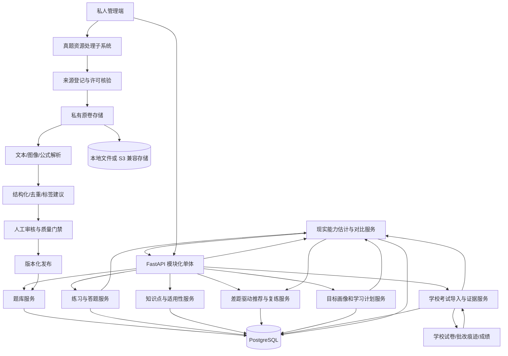
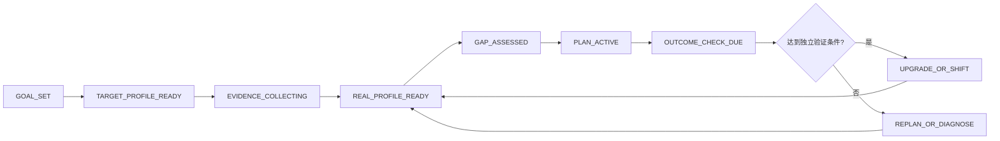
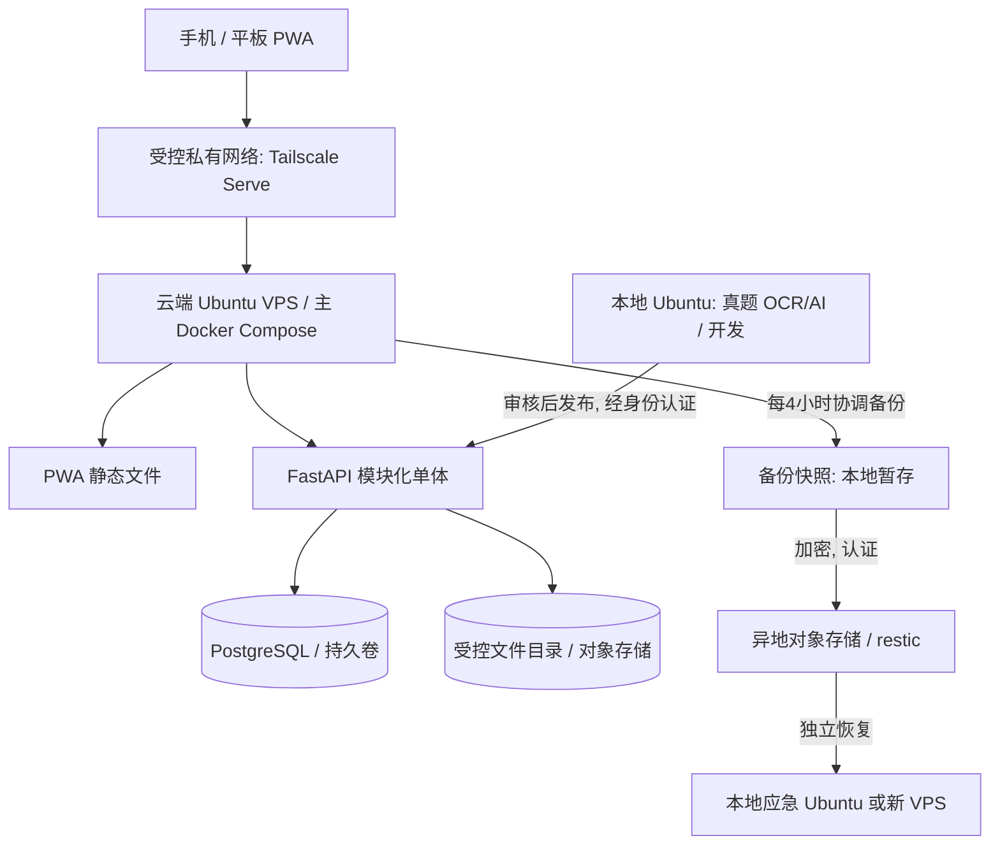

# 书童（ShuTong）｜北京市中考真题智能练习系统

> **整体设计方案 V1.4** · 2026-10-17  
> 阶段：个人非商业使用与产品可行性验证 · 状态：设计基线，待样本试卷验证  
> 本版变更：在 V1.3 的真题管理、四科学习闭环及目标—现实能力 GAP Engine 基础上，增加**低成本稳定运行架构、数据资产分级、RPO/RTO、协调异地加密备份、故障恢复操作手册和恢复演练标准**。

## 0. 一页结论

**产品定位：** 面向北京市初三中考冲刺学生的个人 Web/PWA 练习工具。以可追溯的历年真题和有质量等级的学习证据为基础，形成“真题入库—设定目标—构建目标画像—建立现实画像—差距诊断—训练干预—独立效果验证—策略迭代”的闭环。

**固定边界：**

| 项目 | 当前决定 |
|---|---|
| 名称 | 书童（ShuTong） |
| 用户 | 初三中考冲刺，初期单人使用/少量受控测试 |
| 学科 | 语文、数学、英语、物理 |
| 终端 | 响应式 Web + 可安装 PWA；手机优先 |
| 商业状态 | 不收费、不公开分发题库；将来扩大使用前重新评估权限 |
| 真题策略 | 优先 2025—2026 年，逐步回溯到 2018 年；历史卷按适用性重新归类 |
| 目标与现实画像 | 同一能力框架，目标以现行考试蓝图约束；现实以日常练习、学校试卷和独立诊断为证据 |
| 自适应策略 | 差距驱动的规则推荐与周期复评；不对未经校准的中考分数作保证 |
| 工程策略 | 模块化单体 + 独立内容处理管线；单机私有常驻 + 本地应急恢复 + 异地加密备份 |

**最重要的产品边界：** 四学科在首版共用题库/答题/复练平台，不代表一次性支持作文自动精评、英语真实听说机考或物理实验操作评分。

---

## 1. 背景与现实约束

2026 年北京中招录取总分为 510 分，计入总分的科目为语文、数学、外语、道德与法治、物理、体育与健康。书童首批选择四门文化学科，是**产品范围选择**，并非全部考试科目的覆盖声明。2026 年外语 100 分中，笔试 60 分、听力口语 40 分；物理 80 分中，笔试 70 分、实验操作 10 分。因此书童第一版覆盖**这四科的可数字化试题练习**，对未实现的考试环节明确标注缺口。

历史卷可能对应旧考试制度。必须同时保留**原卷原貌**及**对现行要求的训练适用性标注**，不能将 2018—2024 年试卷未经检查直接用作 2026 年格式的整卷模拟。

**政策核对：** [北京教育考试院：2026 年初中学业水平考试问题解答](https://www.bjeea.cn/html/zkzz/faq/2026/0610/88185.html)。

## 2. 产品目标、非目标与验证假设

### 2.1 用户价值

- 迅速开始：5/10/15/20/30 分钟训练计划，一键进入。
- 有依据地练：每题都能追踪年份、学科、试卷、题号和来源。
- 针对弱项：知识点专项、错题复练和独立新题验证。
- 正确记录：保存每一次作答、用时、提示使用、自评和题目版本。
- 把反馈变为下一次行动：报告必须指向可执行练习，而非只展示统计。

### 2.2 首版不做

完整商业化 SaaS、多租户、社交排行榜、家长付费、复杂 AI Agent、全自动作文或证明题判分、英语机考仿真、物理实验操作仿真、未经测量校准的精确中考分数预测和实时在线爬取任意站点。

### 2.3 核心待验证假设

1. 能够持续获取**适合个人使用**、可追溯且质量合格的真题资料。
2. PDF/Word/图片经半自动管线能够以可承受的人力成本转成题库。
3. 根据目标—现实差距安排练习，比无目标刷题更可能改善独立新题表现（待验证假设）。
4. 学校试卷可被准确拆分、录入题目得分，并在明确的考试性质约束下辅助定位薄弱点。
5. 学生能够快速开始并完成短时练习。

## 3. 系统总体架构



### 3.1 核心模块与优先级

| 模块 | 核心职责 | 优先级 |
|---|---|---|
| **真题资源管理子系统** | 来源、采集台账、导入、解析、拆题、审核、发布 | P0 |
| **目标画像与目标管理**（V1.3 新增） | 目标分、考试年份、能力标准、时间预算与路径约束 | P0 |
| **学校试卷与成绩导入**（V1.3 新增） | 试卷/批改件上传、题目得分校对、考试类型及可信度 | P1 |
| **现实画像与差距引擎**（V1.3 新增） | 多源证据、薄弱项、数据不足项、能力差距与提升优先级 | P1 |
| **计划执行与动态调度**（V1.3 新增） | 步骤化学习计划、每日任务、效果验证与计划修订 | P1 |
| 知识点与试题关系 | 四学科知识树、题目关联与改革适用性 | P0 |
| 真题练习 | 按年份、题型、知识点搜索与训练 | P0 |
| 答题记录 | 自动判客观题、主观题核对/自评、版本记录 | P0 |
| 错题与复练 | 错误归类、复练队列、答对后的独立验证 | P0 |
| 学习首页 | 训练入口、今日练习安排、历史进度 | P0 |
| 阶段测评/成长报告 | 知识点表现、用时、趋势、证据量 | P1 |
| 智能推荐 | 可解释的难度匹配、薄弱项与复习调度 | P1 |
| AI 分步辅导 | 提示与引导，审核答案优先于模型输出 | P2 |

**边界原则：** 采集/解析数据处于“待审核区”；只有满足审核、来源与权限要求并成功发布的题目才允许进入学生练习 API。

## 4. 新增子系统：真题资源获取与结构化处理

### 4.1 职责与输入输出

**输入：** 手动下载或合法渠道获取的 PDF、Word、图片、音频、答案、解析、来源链接；按年份/学科登记。  
**输出：** 标准化 `exam_papers`、`question_groups`、`questions`、`question_parts`、`answer_keys`、`rubrics`、`assets`、`question_knowledge`、审核历史及原卷追踪信息。

子系统分为六个可独立测试的流程：

| 流程 | 行为 | 主要输出 | 质量门禁 |
|---|---|---|---|
| A. 来源发现与登记 | 记录站点/作者/年份/学科/入口/访问条件 | `source_manifest` | 不把搜索结果视为已下载 |
| B. 合规获取与留存 | 允许的方式取得文件，保存原样、SHA-256 | `source_files` | 不绕过登录、会员限制、验证码 |
| C. 文本与版面解析 | 文本提取；公式、配图、题组关系定位 | `parse_jobs`、草稿数据 | 失败时保留原文截图供校对 |
| D. 结构化与关联 | 答案/评分细则、标签建议、试题去重 | 草稿题、知识链接 | AI 输出不得直接发布 |
| E. 审核与修订 | 对照原卷校对答案、配图、材料、知识点 | `review_logs`、版本记录 | 核心字段全部审核通过 |
| F. 发布与追踪 | 审核通过后原子发布、记录版本号 | 学生端可查询题目 | 旧练习记录仍指向旧版本 |

**状态机：** `DISCOVERED → DOWNLOADED → PARSED → STRUCTURED → IN_REVIEW → APPROVED → PUBLISHED`，任一步可转 `NEEDS_FIX`，撤回使用 `RETIRED`，不得从 `PARSED` 跳过审核直接 `PUBLISHED`。

### 4.2 资源渠道与收集方式

先人工收集，后自动处理。可用于**查找线索**的站点（实际可下载性和使用许可逐项核验）：

- [北京教育考试院](https://www.bjeea.cn/)：官方政策、考试制度、题目评析等事实核对，不预设提供齐全真题文件。
- [北京高考在线：2026 年北京中考试题、答案及试卷评析汇总](https://www.gaokzx.com/gk/zhongkao/156894.html)：包含四学科资源入口；第三方整理站点，不能把公开访问等同于再分发许可。
- [北京高考在线：2025 年汇总](https://www.gaokzx.com/gk/zhongkao/142623.html)：用于按年度交叉检查题号和答案。

收集顺序：**2026、2025 → 2022—2024 → 2018—2021**。以“年份×学科×考试版本”为试卷单位。2018—2026 年 9 年 × 4 学科 = **36 个潜在组合**，是索引目标，不是现已下载/验证的数量。

**版权原则：** 个人非商业学习并不自动授予公开复制、分享或再发布的权利。根据《著作权法》第二十四条，个人学习等属于有条件的合理使用情形，但须符合相关限制。记录来源、作者/平台、授权或限制；私人资料仓库不提交公开代码库。扩大试用、分享原卷或公开部署前复核使用权。参考：[国家版权局《中华人民共和国著作权法》](https://www.ncac.gov.cn/xxfb/flfg/flfg_532/202103/t20210309_50530.html)。

### 4.3 数据存储分区

```text
shutong-data/                           # 独立私有仓库，不公开提交
├── manifests/
│   ├── source_manifest.csv             # 来源台账与获取状态
│   └── rights_register.csv             # 来源与使用限制
├── raw/
│   └── <year>/<subject>/               # 原始文件，保留 SHA-256
├── working/
│   ├── extracted/                       # 文本、公式、资源定位
│   └── drafts/                          # 未审核题目 JSON
├── verified/
│   ├── questions/                       # 审核通过的标准题目
│   └── papers/
├── assets/                              # 图片、音频等
└── reports/
    ├── coverage.csv
    ├── quality_report.json
    └── import_log.jsonl
```

建议在 `source_manifest` 中至少记录：`source_id`, `year`, `subject`, `source_url`, `publisher`, `source_kind`, `download_status`, `rights_status`, `access_note`, `original_filename`, `sha256`, `acquired_at`, `answer_source_url`, `review_status`。

`rights_status` 推荐 `UNKNOWN | PERSONAL_REVIEW_ONLY | LICENSED | PUBLIC_DOMAIN_CONFIRMED | RESTRICTED`，**默认 `UNKNOWN`**；该状态是内部管理判断，不自动构成法律结论。

### 4.4 学科解析特殊要求

| 学科 | 重点保真 | 首版判分 |
|---|---|---|
| 数学 | LaTeX、函数图像、几何图、分步证明 | 选择/填空自动；证明/综合题对照与自评 |
| 语文 | 长文材料、题组与子题、古诗文、作文题 | 客观题自动；阅读简答/写作采分点自评 |
| 英语 | 阅读篇章、题组、选项、文本和音频引用 | 客观题自动；写作自评；听说机考不仿真 |
| 物理 | 电路图、实验装置、坐标图、单位和计算步骤 | 客观题自动；实验分析/计算题自评 |

一个阅读材料可链接多道子题；不同年份或站点重复转载同一道题，不应自动生成多份彼此不关联的训练实体。去重按**文件哈希 + 标准化题干相似度 + 图片特征 + 人工复核**，禁止仅凭相似文本自动合并不同题目。

### 4.5 题目审核发布规则

**必选校验：** 题干完整、原题号与试卷关联正确、答案依据存在、配图/公式可见、内容与学科匹配、知识点标签已复核、考试版本适用性已标注、来源和权利状态已登记。

**发布策略：** 个人本地资料可以进入私有审核工作区；学生练习库只包含审核通过且符合当前使用范围的题目。每次内容变更新建版本，`answer_attempts.question_version_id` 永不指向浮动的“最新版本”。

### 4.6 首批内容验收

- **阶段 0 样本：** 40 道以上覆盖四学科代表性题型的人工审核真题（不是 40 个文件）；优先验证各科最难解析的类型。
- **阶段 1 可用题库：** 试点 80—120 道已审核题目，支持核心完整练习闭环；数量是规划阈值，不以凑数牺牲覆盖。
- **后续扩充：** 400—600 道独立题目或题组作为迭代目标，随来源可用性和人工审核产能调整。

## 5. 学习系统的核心业务闭环


**五种练习模式：** 历年原卷、知识点专项、错题复练、短时综合诊断、目标差距驱动训练。差距驱动模式须在可用目标与现实证据建立后启用；若证据不足则先进行定向诊断，不假定学生不会。

**答题事件最小字段：** `learner_id`、`session_id`、`question_id`、`question_version_id`、`answer_payload`、`duration_ms`、`hint_count`、`scoring_method`（auto/self/manual）、`score_obtained`、`max_score`、`confidence_self_report`（可选）、`mistake_type`、`answered_at`。

**掌握度解释：** 正确率、独立程度、时间、复练间隔和未见题迁移表现共同构成证据。初始模型采用可解释规则与证据量，不能将内部掌握度直接映射为北京中考录取分数。

## 6. 数据库模型与约束

### 6.1 主要实体

| 数据域 | 表/实体 | 主要职责 |
|---|---|---|
| 资源 | `sources`, `source_files`, `rights_records`, `import_jobs` | 溯源、限制、文件哈希、批处理状态 |
| 试卷 | `exam_papers`, `paper_questions` | 年份、学科、原卷题号、考试制度版本 |
| 题目 | `question_groups`, `questions`, `question_parts`, `question_versions` | 题组、子题、版本、内容 |
| 内容 | `question_assets`, `answer_keys`, `rubrics` | 图文音频、正确答案、采分点 |
| 知识 | `knowledge_points`, `question_knowledge`, `knowledge_relations` | 层级、主/次考点、前置知识 |
| 审核 | `review_logs`, `publication_events` | 人工检查和题目发布追踪 |
| 学习 | `learners`, `practice_sessions`, `answer_attempts` | 本地个人档案与作答事件 |
| 目标 | `score_goals`, `goal_versions`, `exam_blueprints`, `target_abilities` | 分数目标、口径、考试蓝图和可达路径假设 |
| 校内考试 | `school_exams`, `school_exam_files`, `school_exam_items`, `school_score_records` | 批改试卷、原始成绩、题目分值与证据审核 |
| 证据画像 | `ability_evidence`, `ability_snapshots`, `gap_assessments` | 可靠性、时效、维度估计、不确定性与差距 |
| 计划 | `improvement_plans`, `plan_steps`, `assignments`, `effect_checks`, `plan_revisions` | 干预步骤、完成情况、对照测验与调度变更 |
| 推荐 | `mastery_states`, `review_tasks`, `recommendation_logs` | 可解释的学习状态和推荐依据 |

### 6.2 必须实施的约束

- `question_versions` 不可变；每次内容修订产生新版本。
- `answer_attempts` 引用具体题目版本；不得因改题而静默改历史记录。
- `exam_papers` 包含 `exam_policy_version`；`questions`/关联表包含 `current_exam_applicability`。
- 题目和原卷均有 `source_file_id` / `source_id` 可追溯关系。
- 题组与子题明确区分；作文与阅读题中的“多问”不会在统计时重复计数。
- `PUBLISHED` 的题目必须具备已审核的答案或明确的人工自评评分说明；前端只查询发布视图。
- 用户数据与内容资产物理或逻辑分离，支持导入导出、备份恢复和删除。

### 6.3 标准题目草稿示例（不是历年真实试题）

```json
{
  "id": "DEMO-MATH-001",
  "subject": "math",
  "group_id": null,
  "paper_id": null,
  "original_question_no": null,
  "type": "single_choice",
  "stem": "示例：若 x + 2 = 5，则 x = ?",
  "options": ["1", "2", "3", "4"],
  "answer": {"value": "3", "source_verified": false},
  "knowledge_points": [
    {"id": "MATH-ALG-001", "role": "primary"}
  ],
  "assets": [],
  "exam_policy_version": "2026",
  "current_exam_applicability": "unverified",
  "rights_status": "UNKNOWN",
  "status": "DRAFT",
  "version": 1
}
```

## 7. 新增核心：目标—现实能力对比与自适应提升子系统（GAP Engine）

### 7.1 设计目标与基本边界

**五项能力（业务闭环）：**
1. 学生设定具体中考目标分（总分和/或科目）并配置考试年份、每日投入和时间约束；系统建立**达到目标所需的候选能力路径**（目标能力画像）。
2. 汇集每日练习、已批改学校试卷、官方/高质量真题的独立诊断结果，形成附证据量和质量标识的**现实能力画像**。
3. 对两份画像按同一学科与考试蓝图进行比较，明确**能力差距、证据缺口、可能可挽回分值与训练性价比**，形成有先后顺序的训练步骤。
4. 按步骤自动调整每日习题：先补前置知识，再做方法训练，再做变式题及限时新题。
5. 用未见过、难度和考点覆盖可比的题目作独立效果验证，并依据效果、剩余时间与学校新考试成绩重新规划。

**严格界限：** 目标分数只是一项意图，不等于能反推某个唯一的“目标能力”；学生当前能力与中考分数也不是可由少数训练题唯一确定。系统必须保存不确定性和“尚无足够证据”的状态；不得输出“练习 X 天必涨 Y 分”。

**考试分值边界（截至本版依据 2026 北京政策）：** 总分 510；首批四科语文 100、数学 100、外语 100、物理 80，共 380 分。但其中外语听说 40、物理实验操作 10，初版题库训练并未完整覆盖。因此**直接数字化可训练的笔试对应分值上限为 330 分**（语文 100 + 数学 100 + 外语笔试 60 + 物理笔试 70）；四科尚未支持的 50 分以及其他计分科目的 130 分，应显式标注并允许录入可信外部成绩，不能自动当成已诊断或可由刷题直接提升的分数。

### 7.2 六维共同能力语义层

| 维度 | 目标能力画像 | 现实能力画像 | 数据建议 |
|---|---|---|---|
| 知识掌握 `knowledge` | 特定考点所需独立正确程度 | 多题同考点独立得分及复测 | 考点、正确/部分得分、证据量 |
| 题型与方法 `methods` | 必备解法/题型得分要求 | 不同题型、方法性错因 | 题型/方法标签、错因 |
| 难度适配 `difficulty` | 达标需要处理的题目难度带 | 在已核验难度带上的表现 | 难度来源、覆盖比例 |
| 时间效率 `speed` | 限时完成程度和时间预算 | 真实耗时、超时、未完成 | 题目用时、限时环境标记 |
| 独立稳定 `stability` | 不依赖提示、跨时间保持 | 提示次数、重复测验波动 | 提示/求助、间隔、稳定性 |
| 迁移综合 `transfer` | 能对新情境、新题组迁移方法 | 未练过的变式题表现 | 题目新颖性、题组依赖关系 |

**统一量尺条件：** 同一维度必须使用同样定义和评分准则；对于不同试卷难度、不同学校和不同年份，如果没有锚题、共同考生、充分样本或等值证据，就只报告“本卷得分”和“相关知识维度的表现”，**不得把不同试卷原始得分直接相减当作真实能力差距**。参见 NCME 测验等值相关资料（附录 B）。

### 7.3 目标分数 → 目标能力画像

**目标输入**：`exam_year`、`exam_policy_version`、`target_total`、`target_subject_scores`、`external_subject_assumptions`、`exam_date`、`daily_minutes`、`available_days`、`student_constraints`、`goal_priority`。

**设计规则：**
- 用户可输入目标总分或分别设定四科；若只输入 510 分总分目标，必须明确未覆盖科目的假设区间，不可默认为满分。
- 目标应存为**保守/平衡/冲刺**三种候选组合，可由学生选定；均注明所需的前置基础及时间投入，不承诺结果。
- 候选画像按**当前政策版本 + 经审核试卷的题型分值蓝图 + 考点结构 + 能力等级**生成；历史题目的适用性不能不加区分地混入现行规则。
- 按题型/考点分值权重将目标分数拆解成“需要争取的得分机会”，而非将目标科目分数机械平均分摊到所有知识点。
- 目标每次修改建立 `goal_version`；目标蓝图和现实画像使用相同 `knowledge_taxonomy_version` 及明确的评分口径。

**可解释的评分蓝图（仅对经过校验的考试蓝图使用）：** 在一份具体的蓝图 B 上，按题或评分点 i 的分值 `m_i` 与答对/采分概率 `p_i`，计算计划层面的期望分值 `E[S|B] = Σ(m_i × p_i)`。这是**条件化模拟**，不是未经校准的实际中考预测；若蓝图不具代表性，或 `p_i` 缺乏证据，页面应显示“无法可靠估计”。

### 7.4 学校考试试卷及分数导入（独立受控证据入口）

支持上传学校月考、期中、期末、区级模拟的 PDF、拍照图片或扫描件，以及成绩单。建议两条导入模式：

- **快速录分模式 P0：** 用户手工输入考试时间、性质、科目、得分/满分、题型分项得分；最少依赖 OCR。可只有总分，但只能用于考试结果记录，不能生成细粒度考点诊断。
- **精细试卷模式 P1：** 原卷 + 学生作答 + 老师批改件 + 标准答案/评分依据（如有）→ 图文识别与试题拆分 → 分值/得分提取 → 考点关联 → **人工核对** → 形成题目级证据。

导入步骤：


**必做校验**：`Σ(各题实际得分)` 与试卷总得分一致（允许明示的作文、附加分或未分项部分）；单题得分在 `0~题目满分` 区间；总分不超过满分；不能读取老师红笔批改时要求人工修改，禁止系统擅自填充。保存 `teacher_score_verified`、`ocr_confidence`、`human_confirmed_at` 和缺失得分标识。

**证据优先级并非固定数值权重：** 已批改且逐题核实的学校试卷可作为较高可信的**本卷表现**；独立、限时、覆盖合理的真题诊断更适合更新对应能力维度；日常有提示练习可用于发现错因，但不应等同独立考试表现；主观题自评需要单独标注。跨来源融合依据来源、是否独立、题目与目标蓝图匹配程度、评分可靠性、时间和样本覆盖决定，保留可追溯原因。

**隐私保护**：学校试卷通常含学生姓名、班级、教师批注甚至其他学生信息。上传前建议自动提示遮挡无关身份信息、在本地私有存储、默认不送外部 AI；若选择云端处理应展示数据去向并取得所需同意。

### 7.5 现实能力画像：证据体系与更新规则

对每个 `learner × subject × knowledge/skill` 维护：

- `observed_performance`：经定义的独立得分率（或部分分）；
- `confidence`：低/中/高或可说明的样本可信等级；
- `evidence_count`、`distinct_item_count`、`coverage`、`last_observed_at`；
- `evidence_sources`：学校考试、限时诊断、平时训练、延迟复测；
- `hint_dependency`、`time_pressure`、`mistake_patterns`、`transfer_result`；
- `taxonomy_version`、`ability_model_version`、`snapshot_at`。

能力状态建议至少有 `UNOBSERVED`、`INSUFFICIENT_EVIDENCE`、`DEVELOPING`、`APPARENTLY_MASTERED`、`NEEDS_RECHECK`。未观察 ≠ 零能力；一次答对 ≠ 已掌握。多考点题目应按审核的评分点/标签分配证据，**不能把一道综合题的全部分数重复计入每个考点**。

**更新事件**：完成一次练习、录入已核对校卷、完成独立新题验证、到达周期复测时间、目标/蓝图修订。每次从不可变证据重算快照，保留前一版本供解释和回滚。

### 7.6 差距分析：三种差距而非简单减分

1. **目标差距**：在相同维度、量尺和考试蓝图下，目标要求与现实估计相差多少。
2. **证据差距**：数据太少、主要来自看过提示的题、某些题型完全没测，系统应该先测而不是先补课。
3. **时间与可达差距**：剩余学习时间能否支持计划；不可达时提出降低风险/重排科目与薄弱项的备选方案，而不是重复加题。

**排序原则（规则版）**：候选训练项的价值参考 `可挽回的蓝图分值权重 × 能力缺口 × 预计可训练性 × 前置知识解锁价值 ÷ 预估时间成本`，同时设置证据可信度、当前负担、重复暴露、考试适用性等门槛。所有系数均为待验证的**产品启发式**；证据不足的考点优先进入`DIAGNOSTIC_NEEDED`队列，不应简单判定为优先级低。

**错因识别**：知识缺失、方法路径不熟、审题/表达、计算失误、时间不足、综合迁移困难、证据不清。每个错因都允许人为更正；AI 只能给出带依据的候选判断。

**示例（纯演示，非真实学生）：** 数学二次函数综合题的目标独立得分率设为 80%，当前经过核验的同蓝图新题独立得分率为 50%（样本有限，区间不确定），则“观察差值 30 个百分点”，**不是“中考会丢 30 分”**。若检查发现主要错在前置的函数解析式，计划先补解析式和坐标变换，再做综合新题，而不是盲目刷更多综合题。

### 7.7 学习计划、任务编排与每日自动选题

**计划层级：** `考试目标 → 学科目标 → 能力差距任务 → 周计划 → 每日 5/10/15/20/30 分钟训练包 → 单题/题组`。每一步保存 `why_this_step`（何种证据导致该步骤被安排）、预期改善的能力维度、预计用时、题目选择规则和验证标准。

单次 15 分钟例子（按现实画像动态变化）：

| 时段 | 内容 | 目的 |
|---|---|---|
| 3 分钟 | 前次需复查知识点的独立提取练习 | 检查保持情况 |
| 8 分钟 | 当前最高收益差距的引导/变式练习 | 针对性干预 |
| 4 分钟 | 未见过的同考点独立小测 | 检查是否能迁移 |

**选题规则**：考试适用性通过审核、分值和考点相关、难度与当前状态匹配、最近未过度重复、受试条件满足（限时/无提示）、试题已发布且权限符合当前使用范围。**独立效果验证池 `EVALUATION_HOLDOUT` 与训练池隔离**，避免泄题/记答案污染。

**计划变更触发**：新增高可信学校试卷、验证明显进步或退步、知识点证据过期、复练连续失败、用户修改目标或每日投入、到达每周复盘。避免每做一道题就大幅重排长期计划，减少不稳定体验。

### 7.8 评估是否有效：观察结果、诊断原因与调整动作

**核心效果 KPI（产品内评价，不宣称因果结论）：**

| KPI | 计算口径 | 观察周期 | 禁止的误读 |
|---|---|---|---|
| 未见题独立得分率变化 | 同考点、相近难度/评分规则，验证题得分÷可得分与基线比较 | 每周或若干训练周期 | 训练题正确率上升 ≠ 真实迁移 |
| 关键能力差距收敛率 | 固定版本画像下，优先考点目标缺口的减少幅度 | 每周 | 不同蓝图间不能直接比较 |
| 计划步骤验证通过率 | 完成独立验证且达到预设条件的步骤÷待验证步骤 | 每周 | 做完 ≠ 通过 |

**辅助诊断**：学校考试题型得分、超时率、提示依赖、错因结构、复练保持率、复习负担。**护栏指标**：每次训练超时比例、题库曝光重复率、数据低可信比例、连续失败导致的负担增加。所有比例都显示分母、样本数与考试类型；小样本时只显示观察结果或“不足以判断”。

计划调整示例：

| 验证情况 | 推荐动作 |
|---|---|
| 新题独立表现改善、延迟复测仍稳定 | 降低同类重复，进入更高阶应用或其他短板 |
| 训练题正确但未见题失败 | 改为方法辨析和变式迁移，不宣布掌握 |
| 知识点连续多次失败 | 回退前置知识，缩小步长，必要时采用分步辅导 |
| 独立正确但超时 | 增加限时专项与解题路径优化 |
| 与新校卷的表现不一致 | 核对考试性质、题目覆盖、评分来源与提示条件，必要时追加诊断 |
| 证据不足 | 先做低负担定向诊断，不强行给结论 |

间隔复习和提取练习有教育研究支持，但具体间隔、题量及个体效果仍需随学生反馈校准；不可凭单一训练周期断言能力已经稳定提升（见附录 B）。

### 7.9 核心状态机与版本管理



重要对象版本：`goal_version_id`、`exam_blueprint_version`、`knowledge_taxonomy_version`、`ability_model_version`、`evidence_cutoff_time`、`practice_plan_version`、`evaluation_form_id`。必须可追溯回答：“为什么上周建议练这道题？为什么本周改了计划？”

### 7.10 新增数据模型（建议表）

| 表名 | 主键/关键字段 | 职责 |
|---|---|---|
| `score_goals` | learner_id、exam_year、target_total、daily_minutes、status | 当前目标及约束 |
| `goal_versions` | goal_id、version、changed_reason、created_at | 目标变更历史 |
| `target_abilities` | goal_version_id、subject、skill_id、target_level、blueprint_version | 候选目标画像及依据 |
| `school_exams` | learner_id、exam_kind、date、subject、full_score、received_score、scoring_scheme | 学校考试元数据 |
| `school_exam_files` | school_exam_id、private_file_ref、content_hash、redaction_status | 私有试卷和批改附件 |
| `school_exam_items` | school_exam_id、item_no、max_score、knowledge_links、rubric_ref | 题号、得分点和考点 |
| `school_score_records` | school_exam_item_id、earned_score、score_origin、confirmed_at | 评分核对结果 |
| `ability_evidence` | learner_id、skill_id、source_type、item_version_id、independence、scoring_reliability、observed_at | 不可变证据事件 |
| `ability_snapshots` | learner_id、skill_id、score_or_state、sample_count、confidence、model_version、snapshot_at | 版本化现实画像 |
| `gap_assessments` | goal_version_id、snapshot_id、skill_id、gap_type、priority、reason | 对比结论与证据解释 |
| `improvement_plans` | learner_id、goal_version_id、created_at、status、version | 能力提升计划 |
| `plan_steps` | plan_id、skill_id、prerequisite_id、success_criteria、why_this_step | 可验证训练步骤 |
| `assignments` | plan_step_id、question_version_id、purpose、due_at、result | 每次具体练习安排 |
| `effect_checks` | plan_step_id、evaluation_form_id、baseline_result、followup_result、evidence_quality | 独立评估 |
| `plan_revisions` | plan_id、old_version、new_version、trigger、reason、evidence_refs | 动态计划调整审计 |

**逻辑隔离**：上传学校试卷的“原件/学生姓名/老师批改”不能混入公共可检索真题资产。若通过审核发现校内试题与真题完全相同，只能做内部关联，不自动改变任何源文件的使用权状态。

### 7.11 新 API 契约建议

| 方法与路径 | 功能 | 权限/关键规则 |
|---|---|---|
| `PUT /goals/current` | 设置目标分数和时间预算 | 校验学科分值、录入未覆盖科目假设；版本化 |
| `GET /profiles/target` | 目标画像与多条候选达标路径 | 返回规则、蓝图、未知项 |
| `POST /school-exams` | 建立一次学校考试 | 仅个人账户、隐私提示 |
| `POST /school-exams/{id}/files` | 上传批改卷或试题文件 | 私有文件、哈希、类型校验 |
| `POST /school-exams/{id}/confirm-scores` | 人工确认题号及得分 | 不允许 OCR 草稿直接入证据库 |
| `GET /profiles/actual` | 当前现实能力画像 | 返回证据量、可信度与未测维度 |
| `GET /gaps` | 比较目标与现实 | 返回评分口径与排序理由 |
| `POST /plans/generate` | 根据最新证据生成步骤计划 | 不覆盖历史版本 |
| `GET /plans/today` | 取得当日自适应题单 | 训练题不得泄露验证题 |
| `POST /effect-checks/{id}/submit` | 提交独立验证 | 记录条件、分值及题目版本 |
| `POST /plans/{id}/reassess` | 触发评估与重排 | 留存变更原因与证据引用 |

### 7.12 最小可执行场景与验收用例

**场景**：学生设数学 90 分为目标，上传一份已批改校内数学月考卷，同时完成一套书童的无提示限时诊断题。系统首先记录学校卷的原始分数及覆盖，不把月考原分硬转换成中考预测分。经题号与采分点审核后，将数据与平台独立练习结合，发现“函数解析式→函数几何综合”是可训练瓶颈；生成先修 2 步 + 方法巩固 + 未见题独立验证的计划，并在验证失败时自动回退先修模块。

**验收必须满足：**
1. 同一知识点在目标与现实画像中具有一致 ID、量尺与考试蓝图版本。
2. 导入只有总分、没有题目级评分的学校试卷时，不产生虚假的知识点级能力结论。
3. OCR 识别错误、老师批改不清、学生中断上传时，不污染正式证据库；允许重新校对。
4. 同分不同试卷类型，报告不得直接声称能力同等；不同考试的原分不直接相减。
5. 证据量不足时明确展示“需要诊断”；不将未知当作零掌握度。
6. 训练池和效果验证题池隔离；从训练题正确率上升不能直接判定目标已达成。
7. 每个计划步骤至少包含目标能力、安排理由、训练任务、独立验收条件与下一步动作。
8. 任一次计划调整可追溯触发事件、算法版本及画像快照；历史计划可还原。
9. 目标总分不应自动忽略未支持科目及外语听说、物理实验操作部分。
10. 学校原卷与学生成绩只有授权个人可见，支持导出与删除，PWA 不缓存无保护的敏感附件。

---

## 8. 技术方案与接口约定

| 层级 | 技术建议 | 说明 |
|---|---|---|
| 前端 | React + TypeScript + Vite | 响应式手机优先，复用表单与答题组件 |
| 样式/PWA | Tailwind CSS + Manifest + Service Worker | 轻量缓存；含受限资源时避免公开离线包 |
| 服务端 | Python + FastAPI | 分模块 API；适合复用内容处理脚本 |
| 数据库 | PostgreSQL + SQLAlchemy + Alembic | 关系、题目版本、数据库迁移 |
| 原始存储 | 私有文件系统；可迁移至 S3 兼容存储 | 资源文件单独做哈希、备份 |
| 内容处理 | Python 文档解析 + 可选本地 OCR/AI | 高风险题型人工校验；模型可替换 |
| 部署 | Docker Compose / 本机私有服务器 | 单人部署，避免不必要的微服务 |
| 测试 | Pytest + Playwright | 单元、API、端到端及内容抽查 |

**接口边界示例：**

| 接口 | 行为 | 首版 |
|---|---|---|
| `POST /admin/source-files` | 导入已有文件并登记来源 | P0 |
| `POST /admin/import-jobs` | 发起解析任务 | P0 |
| `GET /admin/import-jobs/{id}` | 解析进度、错误清单 | P0 |
| `POST /admin/questions/{id}/review` | 审核及修改建议 | P0 |
| `POST /admin/questions/{id}/publish` | 规则校验后发布具体版本 | P0 |
| `GET /questions` | 仅检索已发布题目 | P0 |
| `POST /practice-sessions` | 创建练习与题目集合 | P0 |
| `POST /answer-attempts` | 保存作答事件 | P0 |
| `GET /review-tasks` | 获取到期复练题 | P0 |
| `GET /reports/knowledge` | 基于已做题生成表现报告 | P1 |
| `PUT /goals/current` | 保存分数目标与时间约束 | P0 |
| `POST /school-exams` | 学校试卷及得分录入 | P0/P1：手工录分优先，图文导入其次 |
| `GET /profiles/target`, `GET /profiles/actual` | 目标/现实能力画像 | P1 |
| `GET /gaps`, `POST /plans/generate` | 差距诊断和提升步骤 | P1 |
| `POST /effect-checks/{id}/submit` | 独立验证与计划调整 | P1 |

**安全原则：** 管理端需身份校验；原卷存储不暴露为可枚举静态目录；私人远程访问建议 HTTPS 与访问控制。PWA 缓存不应让他人在共享设备上读取原卷或个人答题数据。

## 9. 修改后的实施路线图

**时间估算：** 将原 V1.2 的 8—10 周改为 **12—16 周规划基线**（经验开发者持续开发的粗估，非工期承诺）。增加校内卷导入、双画像、差距引擎和独立验证后，复杂度明显增加；真实试卷校验与小样本模型评估可能持续更久。

| 阶段 | 周期建议 | 交付物 | 退出条件 |
|---|---|---|---|
| M0：合同与蓝图 | W1—W2 | 四科知识/题型蓝图、目标分字段、共享数据契约 | 2026 分值边界和各维度定义可追溯 |
| M1：真题源管线 | W3—W4 | 试卷导入、解析、审核、题目版本 | 40 道代表性题目审核通过 |
| M2：练习基础 | W5—W6 | 四科作答、判分、自评、答题事件 | 端到端练习与记录正确 |
| M3：学校卷入口 | W7—W8 | 手工成绩、文件上传、题目得分人工确认 | 导入校卷且不误读未知数据 |
| M4：双画像差距 | W9—W10 | 目标与现实快照、证据层、差距解释 | 能解释未知项和不同考试的不可比性 |
| M5：计划执行 | W11—W12 | 任务分配、复练、未见题验证、版本更新 | 验证结果能触发有依据的改计划 |
| M6：PWA 质量与试用 | W13—W16 | 设备适配、隐私、协调异地备份、恢复演练、真实试用报告 | 完成多轮对比与系统安全检查，异地全新主机恢复验收通过 |

**并行任务：** W2 起持续扩充已审核题库；不把抓取数量作为项目成功指标。

### 9.1 必须通过的系统验收

- 从一份合法取得的原卷文件出发，能完成“登记→解析→人工审核→发布→学生练习→答题保存”。
- 同一道题修改后历史作答仍能还原当时题干和答案版本。
- 客观题判分经标准答案样本检查正确；主观题明确标示自评，不冒充官方自动评分。
- 断网、刷新与中断后，不产生静默丢失或重复计分的答题记录。
- 对公式、几何图、电路图、长阅读题、题组进行重点抽查；不合格的题不得发布。
- 至少完成一次私有数据备份与恢复演练。
- 学校试卷只录入总分时，不生成知识点能力；逐题得分必须人工确认后才更新画像。
- 目标与现实画像的版本、证据和比对口径一致；无证据时呈现未知。
- 独立新题验证与训练题隔离，计划重排可追溯原始证据与更新理由。
- 有可访问控制，未授权用户无法直接下载原卷或查看学生个人记录。

## 10. 核心指标与风险

### 10.1 第一轮验证指标（内部目标，非已测得表现）

| 指标 | 目标或观察方式 |
|---|---|
| 已发布试题人工审核覆盖 | 100% |
| 作答记录保存与关联 | 关键路径 100% 成功，故障不可静默 |
| 答题阻断型缺陷 | 试用阶段 0 个遗留高优先级问题 |
| 练习完成率 | 以 ≥80% 作为初步目标，观察是否偏离 |
| AI 解析准确性 | 按学科、题型分别记录真实抽样错误率，不虚构总准确率 |
| 错题复练效果 | 在未做过的同考点题上比较独立完成表现 |
| 题库覆盖 | 按年份×学科×题型×知识点统计，不只计算题数 |
| 未见题独立表现 | 比较相近考点、难度和评分条件的前后测试；标明样本量 |
| 优先差距收敛 | 每周用冻结的蓝图与画像版本追踪可比差距；不足时报告未知 |
| 推荐执行有效性 | 计划步骤在独立检验中通过的比例；不把任务完成等同掌握 |
| 隐私与成绩校验 | 上传件默认私有；未知题分不自动赋值；校卷总分与各题分核对 |

### 10.2 主要风险与应对

1. **资源版权与获取限制**：非商业不等于可以公开再分发；来源台账和权限门禁必须早于批量导入。
2. **答案、公式、图像识别错误**：需要原卷对照、多媒体资源检查和人工复核。
3. **历史改革不兼容**：为试卷与试题标注制度版本与现行适用性；旧卷默认不可直接视作现行模拟卷。
4. **未成年人数据**：不采集真实姓名、学校等不必要信息；个人档案最小化、默认本地私有保存。
5. **AI 幻觉**：AI 只提供候选标签和讲解；最终答案/评分依据来自审核记录。
6. **过度工程化**：初期不引入微服务、图数据库、复杂多智能体编排；模块化单体保持可替换接口。
7. **学校试卷与真题不等值**：禁止无校准的原始分数换算；报告考试类型、覆盖、证据质量。
8. **目标过高或自适应过度激进**：提供不同达成策略和阶段性检查；控制练习时长与计划变更频率。
9. **过拟合与泄题**：隔离训练/验证题池，优先使用未见题评估，展示小样本不确定性。

## 11. 建议的工程文件与下一步

```text
shutong/
├── apps/
│   ├── web/                      # 学生 PWA
│   └── admin/                    # 私人审核管理端
├── services/
│   └── api/
│       ├── modules/
│       │   ├── sources/
│       │   ├── ingestion/
│       │   ├── question_bank/
│       │   ├── knowledge/
│       │   ├── practice/
│       │   ├── review/
│       │   └── assessment/
│       └── migrations/
├── pipelines/
│   ├── importers/
│   ├── extractors/
│   ├── normalizers/
│   └── validators/
├── packages/schemas/
├── tests/
├── docs/
│   ├── PRD.md
│   ├── DATA_SPEC.md
│   ├── INGESTION_SPEC.md
│   ├── ARCHITECTURE.md
│   ├── TARGET_PROFILE_SPEC.md
│   ├── SCHOOL_EXAM_IMPORT_SPEC.md
│   ├── GAP_ENGINE_SPEC.md
│   ├── IMPLEMENTATION_PLAN.md
│   └── ADR/
└── infra/compose.yaml
```

**推荐先执行的三个交付：**

1. `DATA_SPEC.md`：冻结试题/试卷/题组/答案/来源/版本/答题事件等基础数据契约。
2. `INGESTION_SPEC.md`：定义资源台账、状态机、解析、人工审核、发布门禁与可观测性。
3. `TARGET_PROFILE_SPEC.md` + `GAP_ENGINE_SPEC.md`：冻结六维能力语义、证据条件、分数目标到能力画像映射、差距优先级和计划重排。
4. `SCHOOL_EXAM_IMPORT_SPEC.md`：定义校卷成绩、逐题校对和隐私门禁。
5. `PRD.md`：明确“目标设定→校卷导入→差距诊断→15分钟训练→独立验证→计划调整”的端到端流程。

**最小演示目标：** 在书童本地 PWA 中，设定数学目标分，导入一份已登记审核的真题及一份已批改校卷（逐题得分人工确认），完成“目标画像→现实画像→差距解释→具体练习步骤→未见题效果验证→计划修订”，所有证据均可回溯、无证据的维度不得冒充已测。

---


## 12. 新增：稳定运行与灾备体系（V1.4）

> 本章为书童整体架构的正式组成部分。详细的实施标准、操作手册、备份任务、完整性检查、故障演练和恢复命令框架，见独立工程文档《书童-稳定运行与灾备机制-V1.0.md》。下文保留完整规范，防止设计方案与运维方案分离。


> **OPS / DR V1.0 · 2026-10-17**  
> 产品：书童（ShuTong），初三四科学习与真题处理系统  
> 适用范围：单人/少量受控测试，非商业部署；用于设计及实施，**不是已上线配置或已通过恢复测试的证明**。

### 12.1. 设计结论和非目标

**推荐：本地开发及重型题库处理 + 一台轻量云主机承载私有 PWA/API/PostgreSQL + 独立异地加密备份 + 可在本地 Ubuntu 重建的应急恢复环境。**

核心排序：数据不丢失 > 故障后可恢复 > 可控费用 > 简单维护 > 绝对在线率。当前不建立 Kubernetes、微服务、双活数据库、负载均衡集群或昂贵监控体系；并且不把云盘快照当作唯一备份。

在仅需家庭内使用的情形，可以全部落在一台独立 Ubuntu 主机上运行，并保持下面相同的备份、镜像、数据库迁移和恢复演练流程。家庭宽带/断电风险使它不如常驻 VPS 适合随时访问。禁止把日常可能关机的开发笔记本当作唯一持久服务器。

### 12.2. 部署选型（可逐步切换）

| 方案 | 适用 | 最小组成 | 主要薄弱点 | 建议 |
|---|---|---|---|---|
| A 本地 Ubuntu 常驻 | 单人且允许偶尔离线 | 本地 Docker Compose + VPN + 异地备份 | 断电、路由器/家庭网络、硬件故障 | 零月租优先 |
| B 轻量 VPS 常驻 | 手机/平板随时使用，极小用户量 | 单 VPS + Docker Compose + 私有访问 + 异地备份 | 单机宕机需手动恢复 | **推荐起点** |
| C 托管数据库/备用云主机 | 用户扩大、恢复目标收紧 | B + 托管 DB 或温备 | 费用/运维复杂度 | 暂缓 |

**B 的初始资源预算**：受支持的 Ubuntu Server LTS；2 vCPU、4 GB RAM、80–100 GB SSD（资源规划假设，部署后按实测增长调整）；数据库和资源附件置于持久卷或持久目录；离线备份预算按实际文件体量及保留期计算。服务端无需 GPU。复杂试卷 OCR、AI 标签、模型推理在本地机器批处理，审核后发布到云端，防止模型占满在线主机的资源。

**网络地域**：以真实使用者的访问位置、网络延迟、服务条款及适用数据合规要求选机房；不要默认某个境外地区到北京都具备稳定访问。私有使用可先不绑定公开域名。

### 12.3. 部署拓扑与最小隔离



- 推荐仅通过受控的私有网络访问。Tailscale Serve 在 tailnet 范围内提供 HTTPS 服务，默认不是公开互联网访问；需按用户和设备配置访问控制。若今后需要面向公众部署，再采用 Caddy HTTPS + 额外身份认证、限流、应用安全审查。
- 数据库端口 5432 **不发布到公网**，FastAPI 容器仅容器内部或 `127.0.0.1` 访问。后端应有独立账户/角色鉴权，不把“知道私有网络网址”视作权限验证。
- 管理端（真题、学校试卷、备份管理）与学生端在权限及 API 层分离；学校试卷先做个人身份信息脱敏。
- 优先 Docker Compose `healthcheck` + 依赖 `service_healthy` + 容器 `restart: unless-stopped`；同时确认宿主 Docker 服务开机启动。依赖健康并不代表业务端到端正确，还需 API 和真实练习流程健康监测。
- 运行版本固化：容器镜像版本、Python/Node 依赖锁、数据库 schema migration 版本；维护变更日志并保留上一版镜像以便回滚。

### 12.4. 数据资产分级与可恢复约束

| 类别 | 示例 | 重要性 | 保护规则 |
|---|---|---|---|
| S0 不可替代动态数据 | 原始作答、学校试卷成绩、上传卷、标注证据、目标/现实画像历史、学习计划执行情况 | 极高 | 数据库/文件每4小时执行协调异地备份，写入审计、恢复校验 |
| S1 难重新加工的数据 | 真题原件、人工审核答案、题目版本、知识标签 | 高 | 每日完整逻辑备份/异地备份；不可覆盖原件，保留内容哈希 |
| S2 可重新生成数据 | 推荐缓存、临时 OCR、缩略图、任务执行缓存 | 较低 | 默认不备份缓存；保留输入与处理版本以重算 |
| S3 可重建的软件资产 | Git 代码、容器配置、迁移脚本、依赖锁定文件 | 高 | 私有版本库 + 离线导出 + 版本标签；备份中留可执行恢复说明 |
| S4 密钥与凭据 | 加密备份口令、对象存储密钥、SSH/应用密钥、MFA 恢复码 | 极高 | 加密密码库 + 离线应急副本；与备份文件分离；测试恢复凭据可用性 |

**关键完整性不变量**：`answer_attempt -> question_version`、`school_exam -> original_asset`、`mastery_snapshot -> evidence IDs`、`training_plan -> model/rule version` 均必须保留引用与时间戳。灾后可自动检查缺失引用、重复作答、损坏附件及迁移不兼容问题。数据恢复不应暗中对过去的学习画像重新评分；若要重算，应生成新版本并保留旧值。

### 12.5. 服务可靠性与运维基线

1. **持久化**：数据库挂载独立持久卷；题库原卷、考试附件和审核文件存于受控持久目录，禁止只放在临时容器文件系统中；对上传目录设置容量、类型和尺寸上限。
2. **基本安全**：默认拒绝入站连接；仅私有网络访问；普通用户运行应用；数据库凭据仅受限文件/密钥服务读取，不进 Git、日志、镜像层或前端；SSH 密钥/多因素认证；最小权限的对象存储访问密钥。
3. **更新**：Ubuntu 自动安装受支持的安全更新，计划维护时窗检查是否需要重启；Docker 和应用依赖按固定频率审查；发布前完成数据库备份，先运行兼容迁移测试。
4. **资源约束**：限制单次上传、并发 OCR/AI 任务、后台工作进程数；设置磁盘容量、水位和日志滚动；云主机不运行大模型推理。
5. **写入可靠**：作答提交采用客户端提交 UUID 或幂等键，断线重试不会生成重复答题记录；每次 API 成功响应以数据库事务提交完成为前提。可选离线 PWA 草稿只作为临时保护，**不是异地备份**，设备缓存可能丢失。
6. **监测告警**：外部私有探针或独立定时任务定期查询 API `/health/live`、`/health/ready` 和真实查询读写检查；监测 5xx、数据库连接数、磁盘剩余、备份成功时间、远端快照完整性。避免健康检查影响正常学生答题。
7. **回滚**：构建和发布使用不可变版本 ID；数据库变更优先向后兼容的两阶段迁移。若迁移不可逆，备份和重建优先于直接降级数据库文件。

### 12.6. RPO / RTO 服务目标（待实测证实）

| 资产/场景 | RPO（目标最大数据损失） | RTO（恢复目标） | 实现前提 |
|---|---|---|---|
| S0 答题记录、能力画像、学校考试、附件 | ≤6小时 | ≤4小时 | 每4小时执行协调异地备份，最近成功快照的新鲜度维持在6小时内；定期验证；不得假定本机快照就满足 |
| S1 真题原件、审核后的题库 | ≤24小时 | ≤4小时 | 每日至少一次异地备份，加上可以重建的版本信息 |
| S3 可运行的软件及配置 | 最近的已验证部署版本 | ≤2小时 | 镜像/源码、配置、恢复手册可获取 |
| 整机/云账号不可用 | 取决于最近成功的完整备份 | 目标4–8小时 | 可以取得新主机、密钥、网络和存储账号；演练确认 |

备注：RTO 不包含第三方故障无法自主控制的等待时间，也不是 SLA。若 VPS 完全故障，需要手动初始化新主机，不自动无缝切换。真实达成与否记录每次演练中的损失数据量和恢复耗时。

### 12.7. 备份策略：3-2-1 的简化落地

**三份副本**：运行中的原始数据 + 云外加密 restic 快照 + 本地独立可恢复副本；**至少两类独立故障域/媒介**：运行主机磁盘与异地对象存储及本地盘；**至少一份异地离线或受独立权限保护的备份**。备份对象存储的恢复权限和删除权限必须与生产应用凭据隔离，必要时启用受服务商支持的版本锁/不可变保留。

| 备份任务 | 建议频率 | 方式 | 校验要求 |
|---|---|---|---|
| PostgreSQL 逻辑备份 | 每4小时 | `pg_dump -Fc` 输出到独立暂存目录，随后 restic 加密上传异地 | 检查 pg_dump 退出码、非空、`pg_restore --list` 与哈希；定期真实恢复 |
| 学校卷和已提交附件 | 每4小时 | 不可变文件/内容哈希 + restic 增量快照 | 备份中引用的附件全部存在且哈希一致 |
| 历年真题原件、审核产物 | 每日 | restic 加密快照 | 源文件哈希、版本清单和引用完整 |
| 配置/迁移脚本/恢复清单 | 每次部署 + 每日 | Git 私有库、快照副本 | 版本与数据库迁移对应；不得把明文密钥放入快照共享区 |
| 第二处独立恢复副本 | 每周 | 受控下载或第二独立仓库 | 物理/账号独立，定期验证可读 |

**数据库与附件的协调一致性**：

1. 上传文件先原子写入受控资源仓库，确认文件完整后再提交数据库引用；已发布文件不可原地覆盖，变更创建新版本。
2. 协调备份流程应创建数据库一致性逻辑快照；然后备份该快照及其所引用的不可变资源文件。备份期间禁止垃圾回收删除任何快照所需的资源。
3. 对备份集合生成 `backup_manifest.json`：备份时间、数据库版本、镜像版本、迁移版本、文件总数、哈希、校验和、关联快照 ID；保留到异地存储。
4. 备份任务只有在 **数据库备份成功、附件可取、远程上传成功、清单自检通过** 后才标记成功。异地上传失败不得隐藏，按时间窗口告警。
5. 避免直接复制正在运行中的 PostgreSQL 数据目录作为可靠热备份；数据库支持官方的 `pg_dump` 或物理基础备份与 WAL 归档。`pg_dump` 本身不能参与 WAL PITR 恢复链。

**保留策略（建议初值）**：最近12份4小时级快照、14份每日快照、8份每周快照和6份每月快照；可按 restic `forget --keep-last ... --keep-daily ... --keep-weekly ... --keep-monthly ...` 实现并定期 `prune`。该策略是配额假设，需确认存储成本和数据增长；勿让生产主机上的自动化任务拥有删除异地“受保护副本”的全部权限。若有不可变/append-only 策略，验证与 forget/prune 的兼容性，不能照抄清理命令。

**加密与密钥**：restic 的密码、仓库访问密钥和 MFA 恢复代码分开保存；至少一套恢复凭据离线留存；安排口令恢复演练。加密口令丢失会导致加密备份无法读取。

**备份检查频率**：每次备份后确认作业状态及远端快照存在；每周执行 `restic check` 和抽样读取内容块；每月至少从异地快照在隔离环境中完成一次完整恢复。检查命令不能代替恢复演练。

### 12.8. 监控和告警矩阵

| 检查项目 | 起始阈值 | 发生问题时动作 |
|---|---|---|
| API 可用性 | 连续3次检查失败（探测间隔建议5分钟） | 检查宿主机/容器，重启异常进程并记故障单 |
| 数据库健康 | 健康检查失败超过2分钟 | 暂停提交入口、检查存储、连接池和磁盘 |
| 磁盘空间 | 使用率 ≥75% 提醒、≥85% 紧急 | 清理可重建缓存、扩盘，禁止直接删数据库文件 |
| 备份延迟 | S0 备份最近成功时间 >5小时 | 立即检查定时器、仓库权限和上传完整性 |
| 数据完整性 | 任何活跃引用缺失附件或校验失败 | 暂停相关题目/学校试卷发布，进入修复 |
| 性能容量 | 真实练习 P95 延迟连续多日升高 | 分析数据库查询与资源占用，必要时升配 |

告警目的地选个人常用的可靠通知方式，并每月验证一次告警链；不要将学生姓名、答题内容或试卷图片写入告警正文。监控服务最好与运行主机分离，否则主机完全断电时监控也会静默停止。

### 12.9. 灾难恢复操作手册（DR Runbook）

#### DR-01：应用容器异常，但数据库正常

1. 查看容器状态与最近日志，记录故障时刻和版本号。2. 确认磁盘空间与 DB readiness。3. 重启指定服务或回滚到上一已验证镜像。4. 用测试账号完成题目查询、提交、错题复练等冒烟测试。5. 保留故障记录。

#### DR-02：误删题目、错误导入或画像被误更新

1. 封锁受影响的写入任务，记录受影响实体、版本、时间范围。2. 优先使用已有题目版本、审核记录和事件历史进行**细粒度回滚**，避免整库回退导致其他正常作答丢失。3. 如细粒度回滚不可用，从隔离恢复数据库中提取所需记录，经一致性审核后迁回。4. 验证关联原件与能力画像快照。

#### DR-03：云主机磁盘损坏 / 整机不可用

1. 从独立终端确认故障，停止指向故障机的入口，记录最近成功异地快照 ID 和时间。2. 准备新 Ubuntu 主机或本地应急机，装 Docker/Compose 与私有网络客户端。3. 取回指定已验证的**数据库 dump + 对应资源快照 + 应用镜像与迁移信息 + 配置**。4. 用兼容的 PostgreSQL 版本恢复数据库；资源恢复后执行校验清单。5. 启动服务，先只读验证用户/试卷/题库/练习数据，完成端到端冒烟测试。6. 在解除维护模式后恢复写入；记录最终数据截止点、数据缺口与实际 RTO。

#### DR-04：备份账号被盗或恶意删除

1. 立即禁用泄露访问密钥、撤销相关令牌、隔离运行机并保留审计日志。2. 从权限独立的不可变副本或离线副本重建**干净的新主机**；不要在未检查的旧主机上直接恢复服务。3. 验证恢复文件、镜像与依赖版本；轮换应用、数据库、对象存储及 VPN 凭据。4. 恢复后进行访问审计和数据完整性检查。

#### DR-05：本地断电或网络中断

- 云端常驻模式：本地 OCR/开发任务暂停，线上已发布题库与练习应继续服务；同步恢复后采用幂等任务重试。
- 全本地部署模式：UPS 可争取有序关机时间；电力或网络恢复后容器自动启动，校验数据库与本地上传文件，确认异地备份仍有效。PWA 仅能保证事先缓存的有限阅读/草稿能力，不能假设离线全功能可用。

### 12.10. 最小恢复命令框架（示意，必须先在测试环境验证）

```bash
# 检查容器状态与健康
sudo docker compose ps
sudo docker compose logs --tail=200 api db

# 检查异地备份仓库与快照（需先安全提供 RESTIC_REPOSITORY 等凭据）
restic snapshots
restic check

# 将选定快照恢复到隔离目录，不直接覆盖当前服务
mkdir -p /srv/shutong-dr-test
restic restore <verified-snapshot-id> --target /srv/shutong-dr-test

# 检查从快照取回的 PostgreSQL 自定义格式备份
pg_restore --list /path/to/recovered/shutong.dump

# 示例：仅在隔离创建的空数据库中导入；版本、角色和迁移需先对齐
createdb -h <db-host> -U <restore-user> shutong_restore_test
pg_restore -h <db-host> -U <restore-user> -d shutong_restore_test   --no-owner --no-privileges /path/to/recovered/shutong.dump
```

这是恢复顺序示例，不是可直接用于生产的自动恢复脚本。`<...>` 是待填写参数。恢复实际数据库前，必须确认与原数据库主版本兼容、角色/扩展完整且使用全新或已明确清空的目标数据库；绝不能将测试还原覆盖线上库。

可选：如果以后把动态学习数据 RPO 提升到 1 小时以内，再评估 PostgreSQL **物理基础备份 + WAL 归档 + PITR**（如使用经过评估的备份管理工具）。这与上面的 `pg_dump` 逻辑备份是两种不同机制，不能混为一谈。

### 12.11. 故障演练与验收准则

| 演练类型 | 频率 | 合格标准 |
|---|---|---|
| 应用进程意外退出 | 每次首部署及主要版本升级 | 自动重启，提交数据不重复，关键流程正常 |
| 误删题目 / 导入错误 | 每月 | 找到版本记录、可撤销、其他作答未丢 |
| 异地完整恢复 | 每月（开始阶段至少每季度） | 从异地仓库独立恢复；引用零缺失；实际耗时记录 |
| 模拟云主机丢失 | 每季度 | 只凭备份及恢复手册，在新主机恢复核心功能 |
| 密钥/权限恢复检查 | 每季度 | 恢复人员能够取得密钥，轮换过程有记录 |
| 仓库完整性扫描 | 每周抽检、每月扩大范围 | `restic check` 无错误，读数据检查与还原测试通过 |

**验收硬门槛：** (a) S0 异地成功快照最大滞后不超过6小时（每4小时运行，预留执行缓冲；超过5小时立即告警；失败期间不得声称达标）；(b) 由备份恢复的数据库记录和附件引用完整；(c) 同一 `client_attempt_id` 重放不造成重复答题；(d) 已完成全新主机恢复演练并记录 RTO/RPO；(e) 密钥不依赖已故障的唯一电脑；(f) 上传考试卷未经授权不可由其他用户访问。

### 12.12. 增量实施顺序与任务验收

| 阶段 | 优先级 | 交付内容 | 验收 |
|---|---|---|---|
| OPS-0 | P0 | 分类数据资产、定义 RPO/RTO 和系统边界 | 清单完成、关键引用关系可追踪 |
| OPS-1 | P0 | Compose 部署、持久卷、健康检查、私有 HTTPS、自动重启 | 模拟掉电/重启后系统恢复，数据库未丢 |
| OPS-2 | P0 | PostgreSQL + 附件的协调备份、restic 异地加密快照、密钥留存 | 连续成功快照 + 异地实际下载恢复 |
| OPS-3 | P0 | 灾备手册与隔离恢复演练 | 从全新空机器恢复完整题库和最近练习数据 |
| OPS-4 | P1 | 外部健康监测、备份失败通知、容量告警 | 人为制造故障能在规定时间收到告警 |
| OPS-5 | P1 | 版本回滚、部署自动化、定期审计 | 故障前后可证明数据、镜像、迁移版本一致 |
| OPS-6 | P2 | WAL/PITR、温备和进一步冗余 | 仅在数据价值和故障实际要求提升后评估 |

### 12.13. 运行前验收测试用例（建议）

- **AC-OPS-001**：关停 `api` 进程，容器按配置重启；用户一次提交不会生成重复记录。
- **AC-OPS-002**：重启整台主机后，应用服务、数据库和私有访问自动恢复。
- **AC-OPS-003**：从独立远端仓库恢复 DB+附件，随机抽样题目/学校考试的附件哈希完全匹配。
- **AC-OPS-004**：丢失云主机本地盘后，在新主机从零部署成功，恢复过程不依赖原机器上的唯一密码。
- **AC-OPS-005**：阻断备份出站网络后，系统在目标备份延迟阈值触发告警，且不标记备份成功。
- **AC-OPS-006**：提前删除/修改已发布题库时，能够追溯原题版本，学生历史答题保持一致。
- **AC-OPS-007**：试用用户不能读取其他人的学校试卷/成绩，即使知道附件原始 ID。
- **AC-OPS-008**：PWA 发生离线重试时以幂等键去重，不能误判已同步的草稿；重新登录后识别未同步数据。

### 12.14. 官方依据（核查日：2026-10-17）

- PostgreSQL 备份与恢复：<https://www.postgresql.org/docs/18/backup.html>；WAL 与 PITR 区别：<https://www.postgresql.org/docs/17/continuous-archiving.html>。
- Docker Compose `depends_on: service_healthy`：<https://docs.docker.com/compose/how-tos/startup-order/>。
- restic 加密仓库及 S3：<https://restic.readthedocs.io/en/stable/030_preparing_a_new_repo.html>；完整性校验：<https://restic.readthedocs.io/en/stable/045_working_with_repos.html>；恢复：<https://restic.readthedocs.io/en/stable/050_restore.html>；保留策略：<https://restic.readthedocs.io/en/stable/060_forget.html>。
- Tailscale 私有 Serve：<https://tailscale.com/docs/features/tailscale-serve>；Caddy HTTPS（将来公开入口时）：<https://caddyserver.com/docs/automatic-https>。
- Ubuntu 自动安全更新：<https://ubuntu.com/server/docs/how-to/software/automatic-updates/>。

---

**基线结论**：书童个人版不必先买商业级高可用能力，但必须在第一位正式用户积累学习数据之前完成自动备份、独立异地副本和一次真实恢复演练。所有 RPO/RTO 属于工程目标，只有通过重复演练才可能成为可信承诺。


## 附录 A：已经核对的外部依据与资源入口（截至 2026-10-17）

- 官方考试制度：[北京教育考试院 2026 年初中学业水平考试问题解答](https://www.bjeea.cn/html/zkzz/faq/2026/0610/88185.html)
- 官方招考政策：[北京教育考试院 2026 年中招相关通知](https://www.bjeea.cn/html/zkzz/zkzc/2026/0410/88027.html)
- 真题汇总线索：[北京高考在线 2026 年试题答案汇总](https://www.gaokzx.com/gk/zhongkao/156894.html)
- 真题汇总线索：[北京高考在线 2025 年试题答案汇总](https://www.gaokzx.com/gk/zhongkao/142623.html)
- 版权法律参考：[国家版权局《中华人民共和国著作权法》](https://www.ncac.gov.cn/xxfb/flfg/flfg_532/202103/t20210309_50530.html)

> **说明：** 汇总网页是资源发现入口，不代表其中每个真题文件已实际获取、可免费完整下载或获得再利用授权。本文所有题量、工期与质量指标均为产品规划建议，需在样本数据与真实试用中验证。

## 附录 B：能力测量与练习方法参考（截至 2026-10-17）

- [NCME：Educational Measurement（5th Edition），Scaling/Equating/Linking](https://ncme.org/wp-content/uploads/2026/01/Educational-Measurement-Fifth-Edition.pdf)：跨试卷分数等值需要满足设计与测量假设，支持“不得随意换算月考/模考/中考分”的系统门禁。
- [NCME：Multidimensional Item Response Theory Equating](https://ncme.org/resources/professional-learning/items/multidimensional-item-response-theory-equating/)：多维能力等值的测量挑战，说明真实能力画像须注意维度与条件。
- [Nature Reviews Psychology (2022)：The science of effective learning with spacing and retrieval practice](https://www.nature.com/articles/s44159-022-00089-1)：支持将分散练习、提取练习纳入候选干预策略；不为个人保证固定提分幅度。
- [Educational Psychology Review (2021)：Retrieval Practice Consistently Benefits Student Learning](https://doi.org/10.1007/s10648-021-09595-9)：为独立提取和复测的教育设计提供研究基础。

> 说明：目标能力阈值、优先级规则与周计划仅为可测试的产品设计假设。上线前应先从少量真实学校试卷与练习证据核验数据质量，再评估推荐效果。
