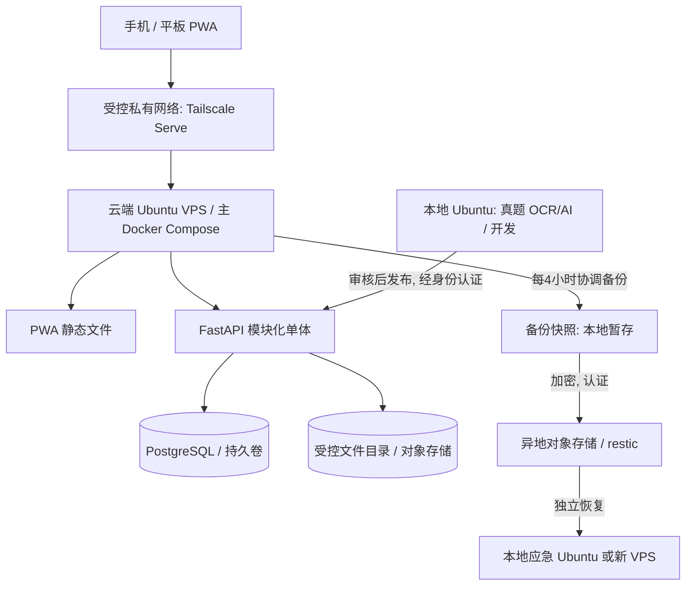

# 书童｜稳定运行环境与灾备实施规范

> **OPS / DR V1.0 · 2026-10-17**  
> 产品：书童（ShuTong），初三四科学习与真题处理系统  
> 适用范围：单人/少量受控测试，非商业部署；用于设计及实施，**不是已上线配置或已通过恢复测试的证明**。

## 1. 设计结论和非目标

**推荐：本地开发及重型题库处理 + 一台轻量云主机承载私有 PWA/API/PostgreSQL + 独立异地加密备份 + 可在本地 Ubuntu 重建的应急恢复环境。**

核心排序：数据不丢失 > 故障后可恢复 > 可控费用 > 简单维护 > 绝对在线率。当前不建立 Kubernetes、微服务、双活数据库、负载均衡集群或昂贵监控体系；并且不把云盘快照当作唯一备份。

在仅需家庭内使用的情形，可以全部落在一台独立 Ubuntu 主机上运行，并保持下面相同的备份、镜像、数据库迁移和恢复演练流程。家庭宽带/断电风险使它不如常驻 VPS 适合随时访问。禁止把日常可能关机的开发笔记本当作唯一持久服务器。

## 2. 部署选型（可逐步切换）

| 方案 | 适用 | 最小组成 | 主要薄弱点 | 建议 |
|---|---|---|---|---|
| A 本地 Ubuntu 常驻 | 单人且允许偶尔离线 | 本地 Docker Compose + VPN + 异地备份 | 断电、路由器/家庭网络、硬件故障 | 零月租优先 |
| B 轻量 VPS 常驻 | 手机/平板随时使用，极小用户量 | 单 VPS + Docker Compose + 私有访问 + 异地备份 | 单机宕机需手动恢复 | **推荐起点** |
| C 托管数据库/备用云主机 | 用户扩大、恢复目标收紧 | B + 托管 DB 或温备 | 费用/运维复杂度 | 暂缓 |

**B 的初始资源预算**：受支持的 Ubuntu Server LTS；2 vCPU、4 GB RAM、80–100 GB SSD（资源规划假设，部署后按实测增长调整）；数据库和资源附件置于持久卷或持久目录；离线备份预算按实际文件体量及保留期计算。服务端无需 GPU。复杂试卷 OCR、AI 标签、模型推理在本地机器批处理，审核后发布到云端，防止模型占满在线主机的资源。

**网络地域**：以真实使用者的访问位置、网络延迟、服务条款及适用数据合规要求选机房；不要默认某个境外地区到北京都具备稳定访问。私有使用可先不绑定公开域名。

## 3. 部署拓扑与最小隔离



- 推荐仅通过受控的私有网络访问。Tailscale Serve 在 tailnet 范围内提供 HTTPS 服务，默认不是公开互联网访问；需按用户和设备配置访问控制。若今后需要面向公众部署，再采用 Caddy HTTPS + 额外身份认证、限流、应用安全审查。
- 数据库端口 5432 **不发布到公网**，FastAPI 容器仅容器内部或 `127.0.0.1` 访问。后端应有独立账户/角色鉴权，不把“知道私有网络网址”视作权限验证。
- 管理端（真题、学校试卷、备份管理）与学生端在权限及 API 层分离；学校试卷先做个人身份信息脱敏。
- 优先 Docker Compose `healthcheck` + 依赖 `service_healthy` + 容器 `restart: unless-stopped`；同时确认宿主 Docker 服务开机启动。依赖健康并不代表业务端到端正确，还需 API 和真实练习流程健康监测。
- 运行版本固化：容器镜像版本、Python/Node 依赖锁、数据库 schema migration 版本；维护变更日志并保留上一版镜像以便回滚。

## 4. 数据资产分级与可恢复约束

| 类别 | 示例 | 重要性 | 保护规则 |
|---|---|---|---|
| S0 不可替代动态数据 | 原始作答、学校试卷成绩、上传卷、标注证据、目标/现实画像历史、学习计划执行情况 | 极高 | 数据库/文件每4小时执行协调异地备份，写入审计、恢复校验 |
| S1 难重新加工的数据 | 真题原件、人工审核答案、题目版本、知识标签 | 高 | 每日完整逻辑备份/异地备份；不可覆盖原件，保留内容哈希 |
| S2 可重新生成数据 | 推荐缓存、临时 OCR、缩略图、任务执行缓存 | 较低 | 默认不备份缓存；保留输入与处理版本以重算 |
| S3 可重建的软件资产 | Git 代码、容器配置、迁移脚本、依赖锁定文件 | 高 | 私有版本库 + 离线导出 + 版本标签；备份中留可执行恢复说明 |
| S4 密钥与凭据 | 加密备份口令、对象存储密钥、SSH/应用密钥、MFA 恢复码 | 极高 | 加密密码库 + 离线应急副本；与备份文件分离；测试恢复凭据可用性 |

**关键完整性不变量**：`answer_attempt -> question_version`、`school_exam -> original_asset`、`mastery_snapshot -> evidence IDs`、`training_plan -> model/rule version` 均必须保留引用与时间戳。灾后可自动检查缺失引用、重复作答、损坏附件及迁移不兼容问题。数据恢复不应暗中对过去的学习画像重新评分；若要重算，应生成新版本并保留旧值。

## 5. 服务可靠性与运维基线

1. **持久化**：数据库挂载独立持久卷；题库原卷、考试附件和审核文件存于受控持久目录，禁止只放在临时容器文件系统中；对上传目录设置容量、类型和尺寸上限。
2. **基本安全**：默认拒绝入站连接；仅私有网络访问；普通用户运行应用；数据库凭据仅受限文件/密钥服务读取，不进 Git、日志、镜像层或前端；SSH 密钥/多因素认证；最小权限的对象存储访问密钥。
3. **更新**：Ubuntu 自动安装受支持的安全更新，计划维护时窗检查是否需要重启；Docker 和应用依赖按固定频率审查；发布前完成数据库备份，先运行兼容迁移测试。
4. **资源约束**：限制单次上传、并发 OCR/AI 任务、后台工作进程数；设置磁盘容量、水位和日志滚动；云主机不运行大模型推理。
5. **写入可靠**：作答提交采用客户端提交 UUID 或幂等键，断线重试不会生成重复答题记录；每次 API 成功响应以数据库事务提交完成为前提。可选离线 PWA 草稿只作为临时保护，**不是异地备份**，设备缓存可能丢失。
6. **监测告警**：外部私有探针或独立定时任务定期查询 API `/health/live`、`/health/ready` 和真实查询读写检查；监测 5xx、数据库连接数、磁盘剩余、备份成功时间、远端快照完整性。避免健康检查影响正常学生答题。
7. **回滚**：构建和发布使用不可变版本 ID；数据库变更优先向后兼容的两阶段迁移。若迁移不可逆，备份和重建优先于直接降级数据库文件。

## 6. RPO / RTO 服务目标（待实测证实）

| 资产/场景 | RPO（目标最大数据损失） | RTO（恢复目标） | 实现前提 |
|---|---|---|---|
| S0 答题记录、能力画像、学校考试、附件 | ≤6小时 | ≤4小时 | 每4小时执行协调异地备份，最近成功快照的新鲜度维持在6小时内；定期验证；不得假定本机快照就满足 |
| S1 真题原件、审核后的题库 | ≤24小时 | ≤4小时 | 每日至少一次异地备份，加上可以重建的版本信息 |
| S3 可运行的软件及配置 | 最近的已验证部署版本 | ≤2小时 | 镜像/源码、配置、恢复手册可获取 |
| 整机/云账号不可用 | 取决于最近成功的完整备份 | 目标4–8小时 | 可以取得新主机、密钥、网络和存储账号；演练确认 |

备注：RTO 不包含第三方故障无法自主控制的等待时间，也不是 SLA。若 VPS 完全故障，需要手动初始化新主机，不自动无缝切换。真实达成与否记录每次演练中的损失数据量和恢复耗时。

## 7. 备份策略：3-2-1 的简化落地

**三份副本**：运行中的原始数据 + 云外加密 restic 快照 + 本地独立可恢复副本；**至少两类独立故障域/媒介**：运行主机磁盘与异地对象存储及本地盘；**至少一份异地离线或受独立权限保护的备份**。备份对象存储的恢复权限和删除权限必须与生产应用凭据隔离，必要时启用受服务商支持的版本锁/不可变保留。

| 备份任务 | 建议频率 | 方式 | 校验要求 |
|---|---|---|---|
| PostgreSQL 逻辑备份 | 每4小时 | `pg_dump -Fc` 输出到独立暂存目录，随后 restic 加密上传异地 | 检查 pg_dump 退出码、非空、`pg_restore --list` 与哈希；定期真实恢复 |
| 学校卷和已提交附件 | 每4小时 | 不可变文件/内容哈希 + restic 增量快照 | 备份中引用的附件全部存在且哈希一致 |
| 历年真题原件、审核产物 | 每日 | restic 加密快照 | 源文件哈希、版本清单和引用完整 |
| 配置/迁移脚本/恢复清单 | 每次部署 + 每日 | Git 私有库、快照副本 | 版本与数据库迁移对应；不得把明文密钥放入快照共享区 |
| 第二处独立恢复副本 | 每周 | 受控下载或第二独立仓库 | 物理/账号独立，定期验证可读 |

**数据库与附件的协调一致性**：

1. 上传文件先原子写入受控资源仓库，确认文件完整后再提交数据库引用；已发布文件不可原地覆盖，变更创建新版本。
2. 协调备份流程应创建数据库一致性逻辑快照；然后备份该快照及其所引用的不可变资源文件。备份期间禁止垃圾回收删除任何快照所需的资源。
3. 对备份集合生成 `backup_manifest.json`：备份时间、数据库版本、镜像版本、迁移版本、文件总数、哈希、校验和、关联快照 ID；保留到异地存储。
4. 备份任务只有在 **数据库备份成功、附件可取、远程上传成功、清单自检通过** 后才标记成功。异地上传失败不得隐藏，按时间窗口告警。
5. 避免直接复制正在运行中的 PostgreSQL 数据目录作为可靠热备份；数据库支持官方的 `pg_dump` 或物理基础备份与 WAL 归档。`pg_dump` 本身不能参与 WAL PITR 恢复链。

**保留策略（建议初值）**：最近12份4小时级快照、14份每日快照、8份每周快照和6份每月快照；可按 restic `forget --keep-last ... --keep-daily ... --keep-weekly ... --keep-monthly ...` 实现并定期 `prune`。该策略是配额假设，需确认存储成本和数据增长；勿让生产主机上的自动化任务拥有删除异地“受保护副本”的全部权限。若有不可变/append-only 策略，验证与 forget/prune 的兼容性，不能照抄清理命令。

**加密与密钥**：restic 的密码、仓库访问密钥和 MFA 恢复代码分开保存；至少一套恢复凭据离线留存；安排口令恢复演练。加密口令丢失会导致加密备份无法读取。

**备份检查频率**：每次备份后确认作业状态及远端快照存在；每周执行 `restic check` 和抽样读取内容块；每月至少从异地快照在隔离环境中完成一次完整恢复。检查命令不能代替恢复演练。

## 8. 监控和告警矩阵

| 检查项目 | 起始阈值 | 发生问题时动作 |
|---|---|---|
| API 可用性 | 连续3次检查失败（探测间隔建议5分钟） | 检查宿主机/容器，重启异常进程并记故障单 |
| 数据库健康 | 健康检查失败超过2分钟 | 暂停提交入口、检查存储、连接池和磁盘 |
| 磁盘空间 | 使用率 ≥75% 提醒、≥85% 紧急 | 清理可重建缓存、扩盘，禁止直接删数据库文件 |
| 备份延迟 | S0 备份最近成功时间 >5小时 | 立即检查定时器、仓库权限和上传完整性 |
| 数据完整性 | 任何活跃引用缺失附件或校验失败 | 暂停相关题目/学校试卷发布，进入修复 |
| 性能容量 | 真实练习 P95 延迟连续多日升高 | 分析数据库查询与资源占用，必要时升配 |

告警目的地选个人常用的可靠通知方式，并每月验证一次告警链；不要将学生姓名、答题内容或试卷图片写入告警正文。监控服务最好与运行主机分离，否则主机完全断电时监控也会静默停止。

## 9. 灾难恢复操作手册（DR Runbook）

### DR-01：应用容器异常，但数据库正常

1. 查看容器状态与最近日志，记录故障时刻和版本号。2. 确认磁盘空间与 DB readiness。3. 重启指定服务或回滚到上一已验证镜像。4. 用测试账号完成题目查询、提交、错题复练等冒烟测试。5. 保留故障记录。

### DR-02：误删题目、错误导入或画像被误更新

1. 封锁受影响的写入任务，记录受影响实体、版本、时间范围。2. 优先使用已有题目版本、审核记录和事件历史进行**细粒度回滚**，避免整库回退导致其他正常作答丢失。3. 如细粒度回滚不可用，从隔离恢复数据库中提取所需记录，经一致性审核后迁回。4. 验证关联原件与能力画像快照。

### DR-03：云主机磁盘损坏 / 整机不可用

1. 从独立终端确认故障，停止指向故障机的入口，记录最近成功异地快照 ID 和时间。2. 准备新 Ubuntu 主机或本地应急机，装 Docker/Compose 与私有网络客户端。3. 取回指定已验证的**数据库 dump + 对应资源快照 + 应用镜像与迁移信息 + 配置**。4. 用兼容的 PostgreSQL 版本恢复数据库；资源恢复后执行校验清单。5. 启动服务，先只读验证用户/试卷/题库/练习数据，完成端到端冒烟测试。6. 在解除维护模式后恢复写入；记录最终数据截止点、数据缺口与实际 RTO。

### DR-04：备份账号被盗或恶意删除

1. 立即禁用泄露访问密钥、撤销相关令牌、隔离运行机并保留审计日志。2. 从权限独立的不可变副本或离线副本重建**干净的新主机**；不要在未检查的旧主机上直接恢复服务。3. 验证恢复文件、镜像与依赖版本；轮换应用、数据库、对象存储及 VPN 凭据。4. 恢复后进行访问审计和数据完整性检查。

### DR-05：本地断电或网络中断

- 云端常驻模式：本地 OCR/开发任务暂停，线上已发布题库与练习应继续服务；同步恢复后采用幂等任务重试。
- 全本地部署模式：UPS 可争取有序关机时间；电力或网络恢复后容器自动启动，校验数据库与本地上传文件，确认异地备份仍有效。PWA 仅能保证事先缓存的有限阅读/草稿能力，不能假设离线全功能可用。

## 10. 最小恢复命令框架（示意，必须先在测试环境验证）

```bash
# 检查容器状态与健康
sudo docker compose ps
sudo docker compose logs --tail=200 api db

# 检查异地备份仓库与快照（需先安全提供 RESTIC_REPOSITORY 等凭据）
restic snapshots
restic check

# 将选定快照恢复到隔离目录，不直接覆盖当前服务
mkdir -p /srv/shutong-dr-test
restic restore <verified-snapshot-id> --target /srv/shutong-dr-test

# 检查从快照取回的 PostgreSQL 自定义格式备份
pg_restore --list /path/to/recovered/shutong.dump

# 示例：仅在隔离创建的空数据库中导入；版本、角色和迁移需先对齐
createdb -h <db-host> -U <restore-user> shutong_restore_test
pg_restore -h <db-host> -U <restore-user> -d shutong_restore_test   --no-owner --no-privileges /path/to/recovered/shutong.dump
```

这是恢复顺序示例，不是可直接用于生产的自动恢复脚本。`<...>` 是待填写参数。恢复实际数据库前，必须确认与原数据库主版本兼容、角色/扩展完整且使用全新或已明确清空的目标数据库；绝不能将测试还原覆盖线上库。

可选：如果以后把动态学习数据 RPO 提升到 1 小时以内，再评估 PostgreSQL **物理基础备份 + WAL 归档 + PITR**（如使用经过评估的备份管理工具）。这与上面的 `pg_dump` 逻辑备份是两种不同机制，不能混为一谈。

## 11. 故障演练与验收准则

| 演练类型 | 频率 | 合格标准 |
|---|---|---|
| 应用进程意外退出 | 每次首部署及主要版本升级 | 自动重启，提交数据不重复，关键流程正常 |
| 误删题目 / 导入错误 | 每月 | 找到版本记录、可撤销、其他作答未丢 |
| 异地完整恢复 | 每月（开始阶段至少每季度） | 从异地仓库独立恢复；引用零缺失；实际耗时记录 |
| 模拟云主机丢失 | 每季度 | 只凭备份及恢复手册，在新主机恢复核心功能 |
| 密钥/权限恢复检查 | 每季度 | 恢复人员能够取得密钥，轮换过程有记录 |
| 仓库完整性扫描 | 每周抽检、每月扩大范围 | `restic check` 无错误，读数据检查与还原测试通过 |

**验收硬门槛：** (a) S0 异地成功快照最大滞后不超过6小时（每4小时运行，预留执行缓冲；超过5小时立即告警；失败期间不得声称达标）；(b) 由备份恢复的数据库记录和附件引用完整；(c) 同一 `client_attempt_id` 重放不造成重复答题；(d) 已完成全新主机恢复演练并记录 RTO/RPO；(e) 密钥不依赖已故障的唯一电脑；(f) 上传考试卷未经授权不可由其他用户访问。

## 12. 增量实施顺序与任务验收

| 阶段 | 优先级 | 交付内容 | 验收 |
|---|---|---|---|
| OPS-0 | P0 | 分类数据资产、定义 RPO/RTO 和系统边界 | 清单完成、关键引用关系可追踪 |
| OPS-1 | P0 | Compose 部署、持久卷、健康检查、私有 HTTPS、自动重启 | 模拟掉电/重启后系统恢复，数据库未丢 |
| OPS-2 | P0 | PostgreSQL + 附件的协调备份、restic 异地加密快照、密钥留存 | 连续成功快照 + 异地实际下载恢复 |
| OPS-3 | P0 | 灾备手册与隔离恢复演练 | 从全新空机器恢复完整题库和最近练习数据 |
| OPS-4 | P1 | 外部健康监测、备份失败通知、容量告警 | 人为制造故障能在规定时间收到告警 |
| OPS-5 | P1 | 版本回滚、部署自动化、定期审计 | 故障前后可证明数据、镜像、迁移版本一致 |
| OPS-6 | P2 | WAL/PITR、温备和进一步冗余 | 仅在数据价值和故障实际要求提升后评估 |

## 13. 运行前验收测试用例（建议）

- **AC-OPS-001**：关停 `api` 进程，容器按配置重启；用户一次提交不会生成重复记录。
- **AC-OPS-002**：重启整台主机后，应用服务、数据库和私有访问自动恢复。
- **AC-OPS-003**：从独立远端仓库恢复 DB+附件，随机抽样题目/学校考试的附件哈希完全匹配。
- **AC-OPS-004**：丢失云主机本地盘后，在新主机从零部署成功，恢复过程不依赖原机器上的唯一密码。
- **AC-OPS-005**：阻断备份出站网络后，系统在目标备份延迟阈值触发告警，且不标记备份成功。
- **AC-OPS-006**：提前删除/修改已发布题库时，能够追溯原题版本，学生历史答题保持一致。
- **AC-OPS-007**：试用用户不能读取其他人的学校试卷/成绩，即使知道附件原始 ID。
- **AC-OPS-008**：PWA 发生离线重试时以幂等键去重，不能误判已同步的草稿；重新登录后识别未同步数据。

## 14. 官方依据（核查日：2026-10-17）

- PostgreSQL 备份与恢复：<https://www.postgresql.org/docs/18/backup.html>；WAL 与 PITR 区别：<https://www.postgresql.org/docs/17/continuous-archiving.html>。
- Docker Compose `depends_on: service_healthy`：<https://docs.docker.com/compose/how-tos/startup-order/>。
- restic 加密仓库及 S3：<https://restic.readthedocs.io/en/stable/030_preparing_a_new_repo.html>；完整性校验：<https://restic.readthedocs.io/en/stable/045_working_with_repos.html>；恢复：<https://restic.readthedocs.io/en/stable/050_restore.html>；保留策略：<https://restic.readthedocs.io/en/stable/060_forget.html>。
- Tailscale 私有 Serve：<https://tailscale.com/docs/features/tailscale-serve>；Caddy HTTPS（将来公开入口时）：<https://caddyserver.com/docs/automatic-https>。
- Ubuntu 自动安全更新：<https://ubuntu.com/server/docs/how-to/software/automatic-updates/>。

---

**基线结论**：书童个人版不必先买商业级高可用能力，但必须在第一位正式用户积累学习数据之前完成自动备份、独立异地副本和一次真实恢复演练。所有 RPO/RTO 属于工程目标，只有通过重复演练才可能成为可信承诺。
